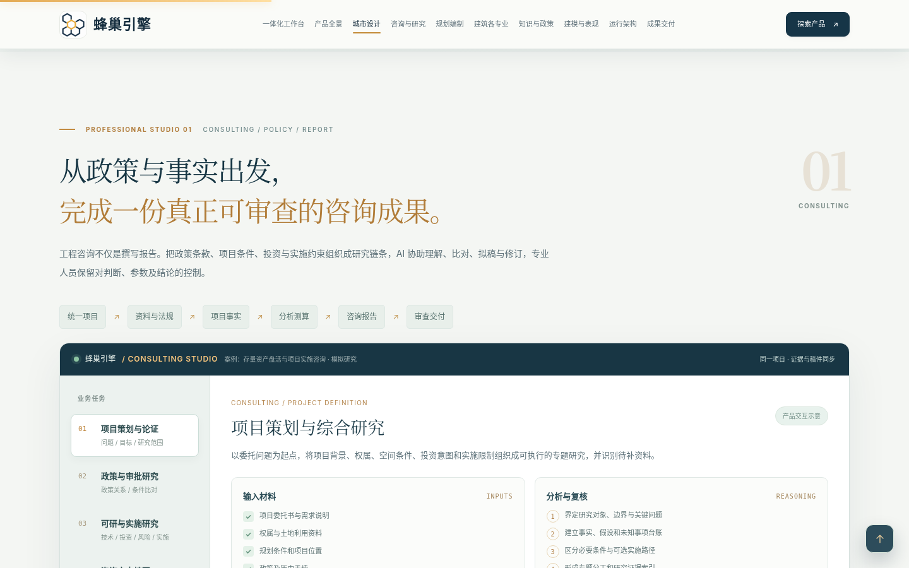
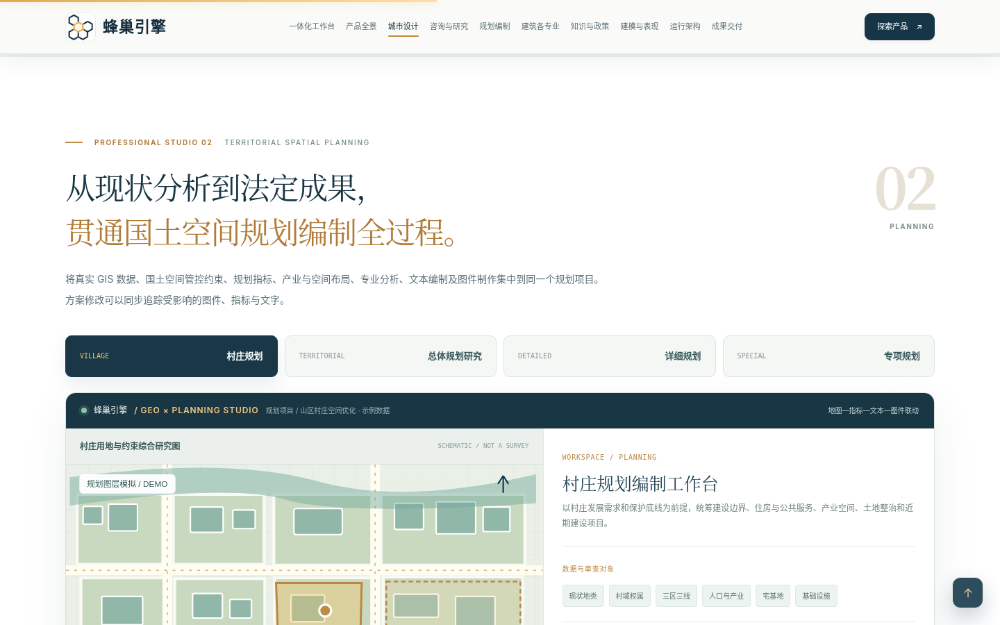
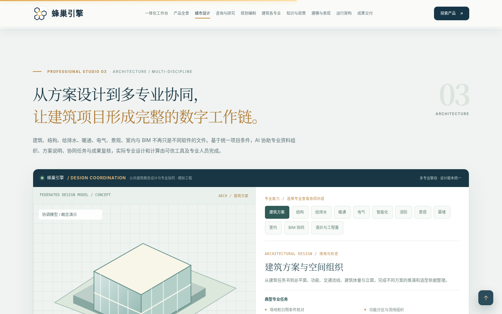

# 蜂巢引擎 · Personal Harness 全景产品展示

**在线预览：<https://liulei97.github.io/fengchao-yinqing/>**

一个统一的 Personal Harness，面向工程咨询、国土空间规划与建筑设计：以任务为组织单元，共享资料、证据、专业软件、模型、审查与可编辑成果。本仓库是其**全景产品展示页**——完整建成形态的交互原型（示例数据），非项目进度展示页，未接通实际政策数据库、GIS 计算服务、BIM 专业软件或 AI 模型。

## 仓库结构

| 文件 | 说明 |
|---|---|
| `index.html` | 展示页本体（原文件名：`蜂巢引擎_PersonalHarness_咨询规划建筑专业深化_完整产品展示.html`，发布时改名为 `index.html` 以便 GitHub Pages 直达） |
| `docs/专业能力与展示内容说明.md` | 产品统一、界面导航、三个新增专业工作台的能力与内容说明（非开发实施计划） |
| `docs/增强模块源码/` | 新增 CSS / JavaScript 的可编辑副本（HTML 已内嵌同样内容，单独打开页面即可运行） |
| `docs/预览图片/` | 三个新增专业视图的桌面 / 移动端产品预览图 |

## 页面特点

- **单文件自包含**：全部样式与脚本内联，图片为 data URI，无任何外部网络请求（页面自带 CSP：`connect-src 'none'`）。
- **纯静态零依赖**：无需构建，任意静态服务器（含 GitHub Pages）可直接托管；`file://` 双击打开亦可。
- **内容覆盖**：统一工作台（项目总览、知识证据、政策关系、咨询研究、规划编制、建筑多专业）、WebGIS 与城市设计全链路、AI 画布与 AI 生图、平台运行架构、成果交付；本次新增**工程咨询、国土空间规划编制、建筑设计十二专业协同**三个专题工作台。
