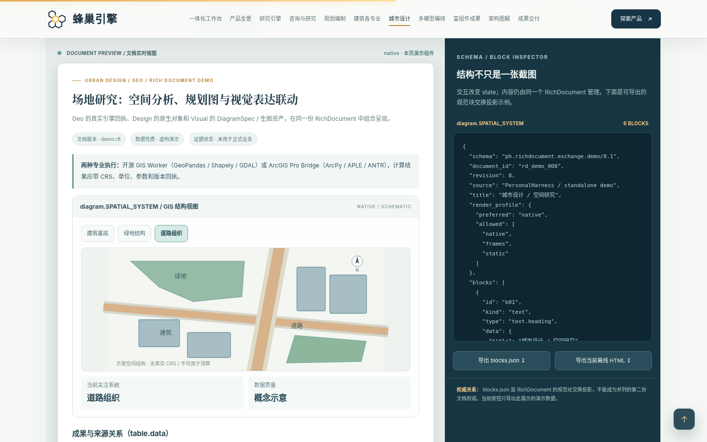
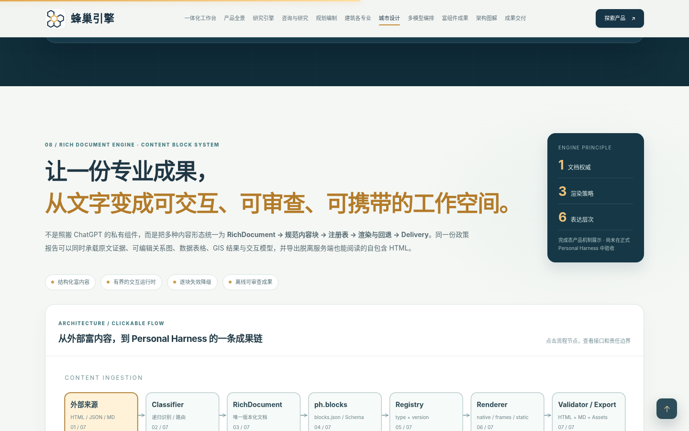
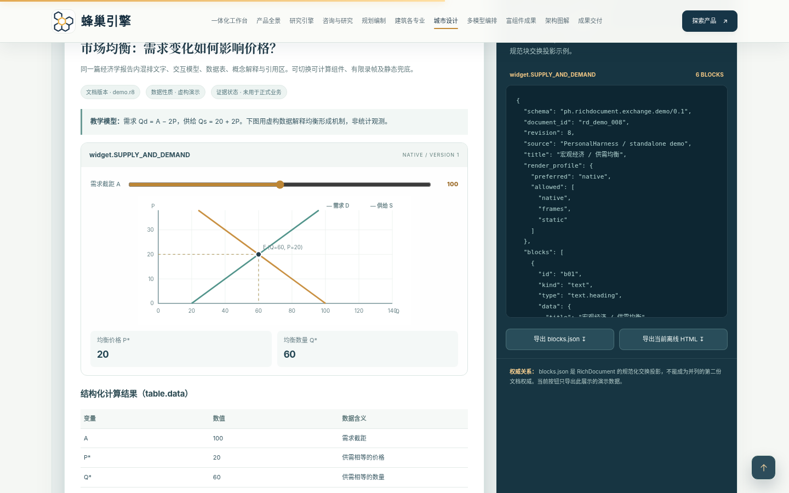

# 蜂巢引擎 · Personal Harness 全景产品展示（第八版）

**在线预览：<https://liulei97.github.io/fengchao-yinqing/>**

一个统一的 Personal Harness，面向政策研究、工程咨询、国土空间规划、城市设计与建筑设计：以任务为组织单元，共享资料、证据、专业软件、模型、审查与可编辑成果。本仓库是其**全景产品展示页**——产品完成态的离线交互原型（示例数据），不代表模型连接、主系统迁移或真实任务执行已完成。

## 当前版本：第八版 · 富组件机制与多模型专业协同

在第七版 Subagent / Model Router 全部展区之上，新增 ChatGPT 式**富组件机制的分层迁移与 RichDocument** 展区：

- **迁移整体机制**：来源 → 递归分类 → RichDocument → 规范块 → Registry → Renderer → 验证/交付，7 节点可点击结构图与节点检视器。
- **L0–L5 表达层**：Markdown、DIL Layout、Chart/SVG、Typed Widget、Stateful JSX、Snapshot 六层横向结构图。
- **三种渲染策略**：native / frames / static，交互切换并展示不同可操作状态。
- **三个业务场景**：宏观经济、政策研究、GIS/城市设计的可混排研究报告内容块（曲线可联动、地图图层可高亮、政策矩阵可切换维度）。
- **内容块结构**：id、kind、type、state、fallback、render_profile 的结构化块示例 JSON 实时可看。
- **迁移分类**：A 类型化 / B 声明式布局 / C 状态型 / D 快照型 / E 生图提示词，点击查看策略与降级方式。
- **本地导出**：真实下载——当前报告的结构化 JSON 与冻结离线 HTML（`docs/samples/` 内含网页导出生成的演示样例）。
- **六领域耦合与迁移顺序**：Knowledge/Policy/Project/Geo/Design/Visual → RichDocument → Delivery 数据流卡片；P1–P6 方案依赖展示（不当作已完成进度）。

关键架构口径：RichDocument 是业务内容的版本化文档权威；任一块失败按 native → frames → static → table/text → 不可用提示分级退化；任务授权/预算/产物接受归 Task Core，富组件引擎不改写政策效力、GeoResult 或设计原生资产。

## 仓库结构

| 文件 | 说明 |
|---|---|
| `index.html` | 展示页本体（原文件名：`蜂巢引擎_PersonalHarness_第八版_富组件机制与多模型专业协同_完整产品展示.htm`，发布时改名为 `index.html` 以便 GitHub Pages 直达） |
| `docs/README_第八版产品展示与技术说明.md` | 第八版官方说明：增强内容、三件事区分、架构决策、测试范围 |
| `docs/57_富组件机制迁移_依据文档.md` | 本次迁移的原始技术底稿（机制解构与落地方案） |
| `docs/assets/` | 各功能模块可编辑源码（`rich-components.*` 为第八版新增；`subagent-multimodel.*` 为第七版；`geo-delivery.*`、`research-architecture.*` 为更早版本参考） |
| `docs/samples/` | 通过页面导出功能生成的演示 JSON 与离线 HTML 样例 |
| `docs/预览图片/` | 桌面 / 平板 / 移动端演示截图 |

构建用 `base_v7.htm` 基线与 `build_revision.py` / `test_revision.py` / `capture_previews.py` 属原制作管线，未收入本展示仓。

## 页面特点

- **单文件自包含**：全部样式、SVG 与脚本内联，图片为 data URI，无任何外部网络请求（页面自带 CSP：`connect-src 'none'`），断网可完整运行。
- **纯静态零依赖**：无需构建，任意静态服务器（含 GitHub Pages）可直接托管；`file://` 双击打开亦可。
- **版本沿革**：第八版（富组件成果引擎）← 第七版（Subagent 多模型编排）← 第六版 ← 第五版 ← 第四版（咨询规划建筑专业深化）← 第三版（全景产品展示首发入库）。
