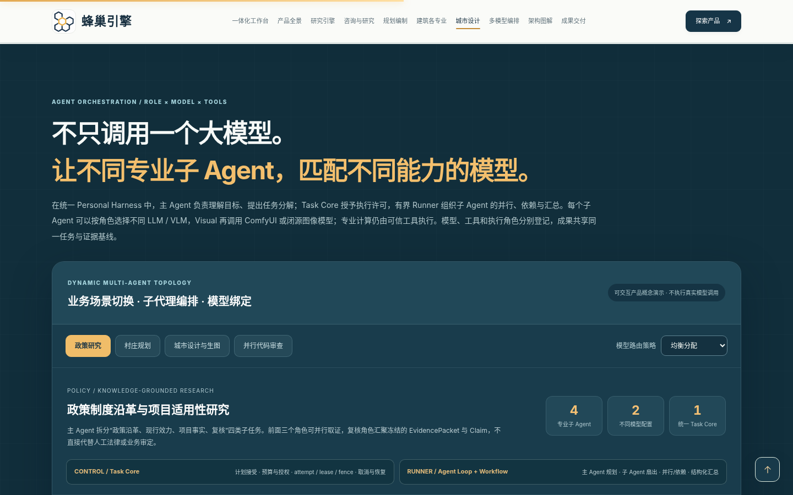
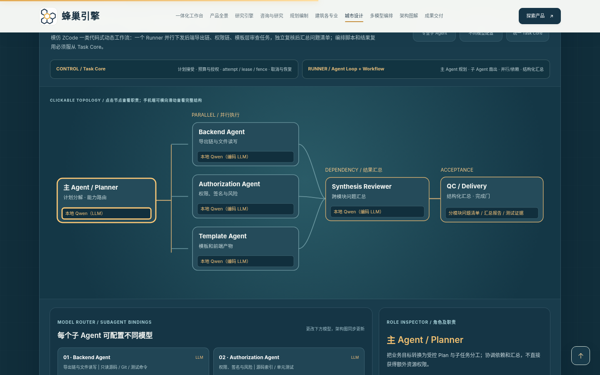
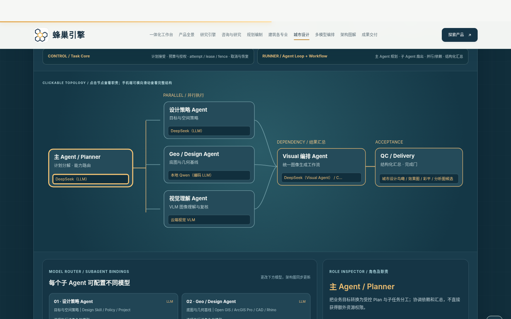

# 蜂巢引擎 · Personal Harness 全景产品展示（第七版）

**在线预览：<https://liulei97.github.io/fengchao-yinqing/>**

一个统一的 Personal Harness，面向政策研究、工程咨询、国土空间规划、城市设计与建筑设计：以任务为组织单元，共享资料、证据、专业软件、模型、审查与可编辑成果。本仓库是其**全景产品展示页**——产品完成态的离线交互原型（示例数据），不代表模型连接或真实任务执行已完成。

## 当前版本：第七版 · 子 Agent 编排与多模型协同

在既有知识检索、政策关系、工程咨询、国土空间规划、建筑设计、WebGIS、城市设计、AI 画布与 AI 生图展区之上，新增：

- **子 Agent 编排工作流**：同一 Task Core 下，主 Agent 计划拆分、并行子 Agent、依赖子 Agent、专业完成门与 Delivery 的互动拓扑，配四个演示场景（政策沿革/项目适用、村庄规划编制、城市设计与 AI 生图、并行代码审查）。
- **子 Agent 与不同模型的动态绑定**：均衡分配 / 本地优先 / 深度研究优先三种示例策略，可逐角色调整模型，拓扑与节点详情同步更新。
- **Visual 开源 / 闭源工作流可选**：ComfyUI 开源工作流、闭源 Image API 或双路线候选切换。
- **三阶段执行轨迹**：规划授权 → 并行执行 → 汇总/QC 的节点高亮演示（仅前端模拟）。

## 仓库结构

| 文件 | 说明 |
|---|---|
| `index.html` | 展示页本体（原文件名：`蜂巢引擎_PersonalHarness_第七版_Subagent多模型编排_完整产品展示.htm`，发布时改名为 `index.html` 以便 GitHub Pages 直达） |
| `docs/README_第七版.md` | 第七版官方说明：新增内容、架构约束、验收结果 |
| `docs/assets/` | 各功能模块的可编辑源码（subagent-multimodel 为第七版新增模块；geo-delivery、research-architecture 为此前版本功能参考源码） |
| `docs/预览图片/` | 桌面 / 移动端演示截图 |

构建用 `source_base_v6.htm` 基线与 `build_revision.py` / `test_revision.py` 属原制作管线，未收入本展示仓。

## 页面特点

- **单文件自包含**：全部样式、SVG 与脚本内联，图片为 data URI，无任何外部网络请求（页面自带 CSP：`connect-src 'none'`）。
- **纯静态零依赖**：无需构建，任意静态服务器（含 GitHub Pages）可直接托管；`file://` 双击打开亦可。
- **版本沿革**：第七版（Subagent 多模型编排）← 第六版 ← 第五版 ← 第四版（咨询规划建筑专业深化）← 第三版（全景产品展示首发入库）。
