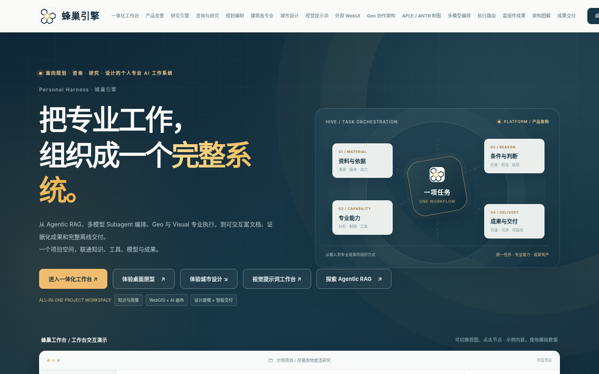
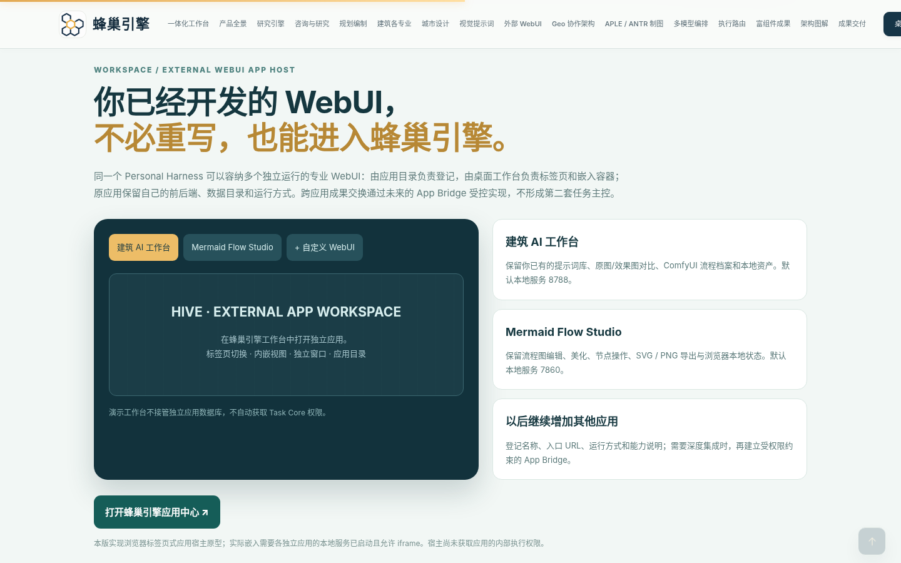
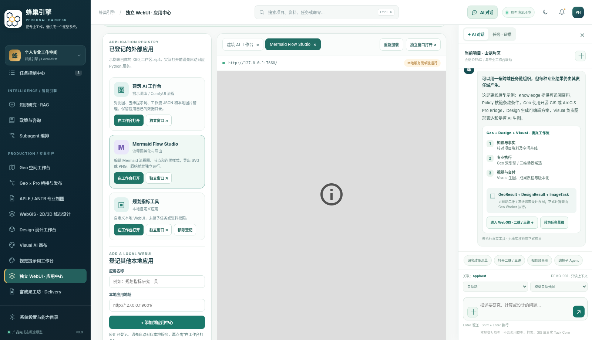

# 蜂巢引擎 · Personal Harness 全景产品展示（V10 · 外部应用工作区）

**在线预览：<https://liulei97.github.io/fengchao-yinqing/>**

一个统一的 Personal Harness，面向政策研究、工程咨询、国土空间规划、城市设计与建筑设计：以任务为组织单元，共享资料、证据、专业软件、模型、审查与可编辑成果。本仓库是其**全景产品展示页**——产品完成态的离线交互原型（示例数据），不代表模型连接、主系统迁移或真实任务执行已完成。

## 双页结构

| 页面 | 说明 |
|---|---|
| `index.html` | 产品展示主页（页面自带标题沿用「第九版」口径；本包主题为**独立 WebUI · 应用中心**）——新设可插拔外部 WebUI 专区 |
| `HiveEngine_Desktop_Concept_v0.8_AppHost.html` | 桌面工作台原型（AppHost 版，页面内标题为 v0.5 · Geo 协作）——左侧新增外部 WebUI 入口，与主页互相跳转 |

两页各自样式内联、图片 data URI、零外部请求，仅靠同目录文件名相对跳转；GitHub Pages 与本地解压均可直接使用。

## 当前版本主题：独立 WebUI · 应用中心

在 V9 视觉提示词工作台展区（Geo、APLE/ANTR、WebGIS、Visual、Agentic RAG、Subagent、Delivery 等）之上，新增「独立 WebUI · 应用中心」：

- **可插拔外部 WebUI 专区**：把独立本地应用（如建筑 AI 工作台、Mermaid Flow Studio）登记进统一入口，跨端口 iframe 嵌入，不合并源码、不改变六领域、Task Core、INDEX 与 Delivery 的权威边界。
- **桌面工作台联动**：桌面原型左侧「独立 WebUI · 应用中心」入口，分别打开各独立应用。
- **App Bridge 边界（如实声明）**：当前仅为集成样例与目标架构演示——未建立真正的消息互通，外部 WebUI 不拥有 Task Core 操作权限；正式方案为经校验 origin、nonce、Schema 与 scope 的消息协议或授权服务端适配器。

## 关于 `apps/` 本地运行包（未收入本仓）

完整包内 `apps/03_WebUI`（Python 标准库服务，127.0.0.1:8788）与 `apps/Mermaid_Flow_Studio`（静态前端，127.0.0.1:7860）为**本地运行形态**：含用户私有 `prompts.json`、图片与备份数据，且 Python 服务无法在 GitHub Pages 运行，故不入本仓。配套 `app_registry.example.json`（应用登记示例）与 `README_外部WebUI应用中心.md`（使用方式与技术边界）已收 `docs/`。本机体验需完整包 + Python 3 运行 `start_hive_workspace.py`。

## 仓库结构

| 文件 | 说明 |
|---|---|
| `index.html` | 产品展示主页（本包 V10 版；发布用根入口） |
| `HiveEngine_Desktop_Concept_v0.8_AppHost.html` | 桌面工作台原型 AppHost 版（取代此前的 v0.4） |
| `docs/README_外部WebUI应用中心.md` | 应用中心官方说明：定位、使用方式、技术边界、安全补充 |
| `docs/app_registry.example.json` | 外部应用登记示例（严格限定 localhost/127.0.0.1/[::1]） |
| `docs/README_第八版产品展示与技术说明.md` | 第八版（富组件）官方说明存档 |
| `docs/57_富组件机制迁移_依据文档.md` | 富组件迁移原始技术底稿 |
| `docs/assets/` | 各功能模块可编辑源码（rich-components / subagent-multimodel / geo-delivery / research-architecture） |
| `docs/samples/` | 页面导出功能生成的演示 JSON 与离线 HTML 样例 |
| `docs/预览图片/` | V10 桌面 / 移动端演示截图 |

## 页面特点

- **自包含 + 相对跳转**：两页各自零外部网络请求（主页 CSP 已收紧至 `script-src 'none'`）；两页之间仅靠同目录文件名相对跳转。
- **纯静态零依赖**：无需构建，`file://` 双击 `index.html` 亦可（跳转入口需桌面临时页在同目录）。
- **版本沿革**：V10（外部应用工作区）← V9（视觉提示词工作台，未经理）← 第八版·执行路由增强（V8 + 桌面概念 v0.4 整合）← 第八版（富组件成果引擎）← 第七版（Subagent 多模型编排）← 第六版 ← 第五版 ← 第四版（咨询规划建筑专业深化）← 第三版（全景产品展示首发入库）。
