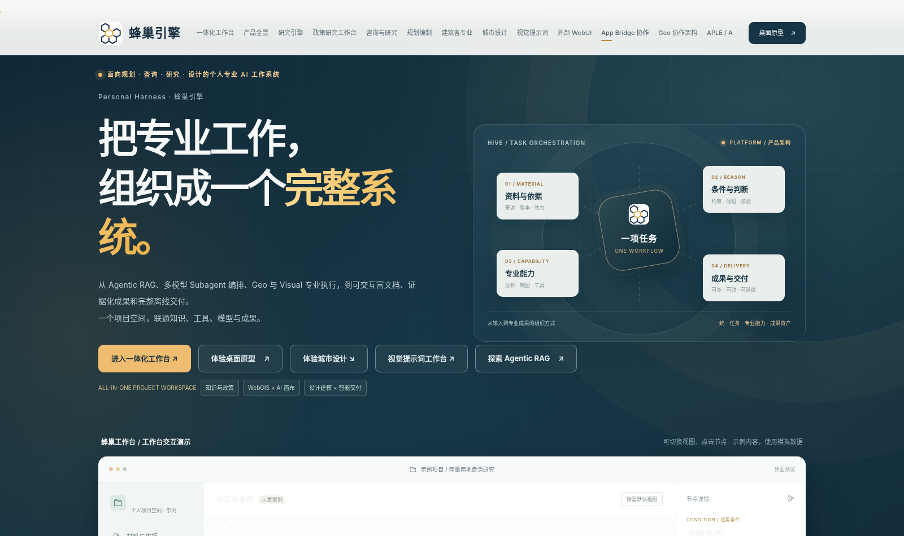
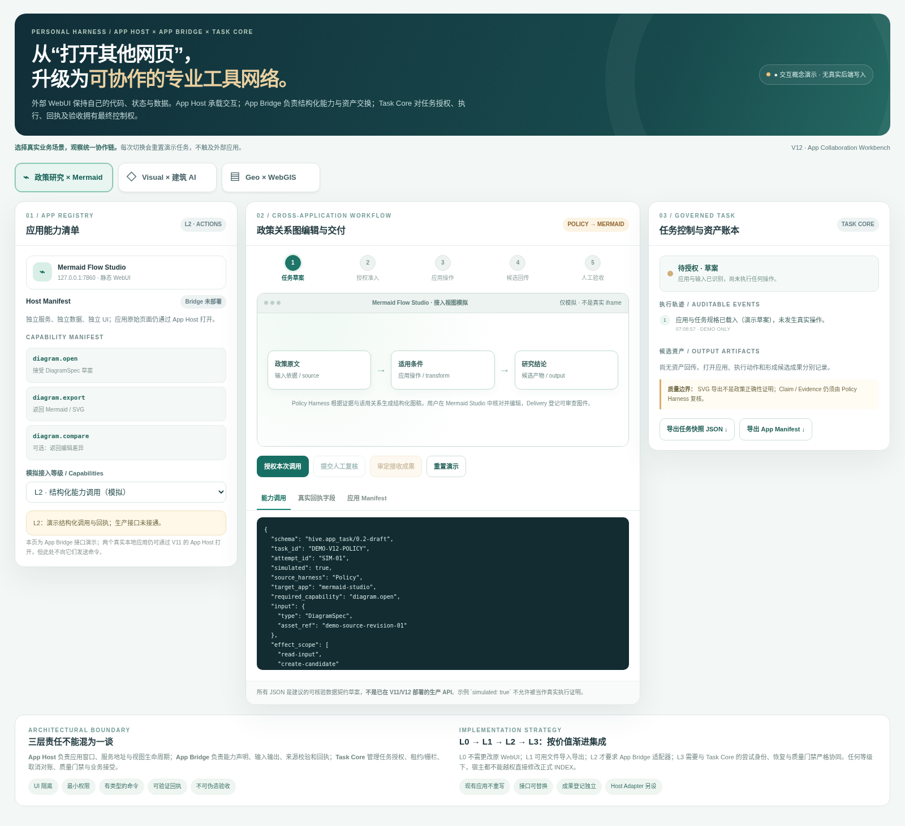
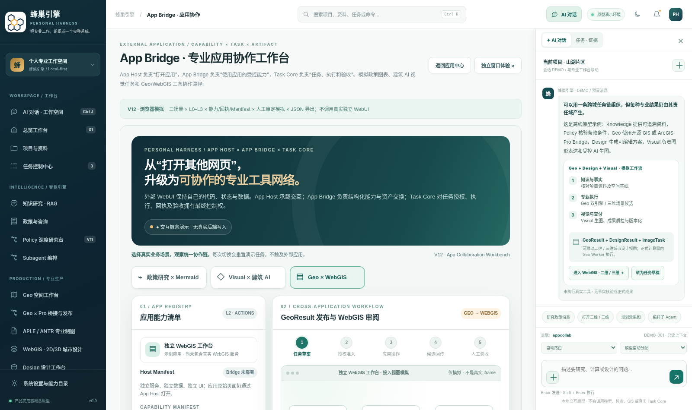

# 蜂巢引擎 · Personal Harness 全景产品展示（V14 · 政策规则库与项目工具包）

**在线预览：<https://liulei97.github.io/fengchao-yinqing/>**
**迭代图谱（历史版本博物馆）：<https://liulei97.github.io/fengchao-yinqing/iteration-map/>**

一个统一的 Personal Harness，面向政策研究、工程咨询、国土空间规划、城市设计与建筑设计：以任务为组织单元，共享资料、证据、专业软件、模型、审查与可编辑成果。本仓库是其**全景产品展示页**——产品概念与可运行前端（示例数据），未接入真实 Task Core、Rule Registry 与 App Bridge 命令调用。

## 页面导航

| 页面 | 说明 |
|---|---|
| [`index.html`](https://liulei97.github.io/fengchao-yinqing/) | **V14 产品展示主页**——导航新增「政策规则与工具包」；V13 分析图工作台、V12 AppBridge、V11 政策研究、应用中心、Geo/APLE/ANTR/Visual 等展区保留 |
| [`Policy_Toolkit_Studio_V14.html`](https://liulei97.github.io/fengchao-yinqing/Policy_Toolkit_Studio_V14.html) | **政策工具包工作室**（V14 独立交互原型，离线可运行）：内嵌 V3 规则/案例/工作流元数据，装配六类候选研究组合 |
| [`Planning_Analysis_Studio_V13.html`](https://liulei97.github.io/fengchao-yinqing/Planning_Analysis_Studio_V13.html) | 规划设计分析图工作台（独立离线 WebUI）：二维/三维图面、GeoJSON/CSV、绘制标注、主题渲染、JSON/SVG/PNG 导出 |
| [`Policy_Research_Workbench_Concept_V11.html`](https://liulei97.github.io/fengchao-yinqing/Policy_Research_Workbench_Concept_V11.html) | V11 政策研究三面板专项工作台 |
| [`App_Collaboration_Workbench_Concept_V12.html`](https://liulei97.github.io/fengchao-yinqing/App_Collaboration_Workbench_Concept_V12.html) | App Bridge 协作原型（授权→打开→编辑回传→复核→审定，导出 JSON 带 `simulated: true`） |
| [`HiveEngine_Desktop_Concept_v1.1_PolicyToolkits.html`](https://liulei97.github.io/fengchao-yinqing/HiveEngine_Desktop_Concept_v1.1_PolicyToolkits.html) | V14 桌面概念工作台——左侧「规则库 · 项目工具包」 |
| [`HiveEngine_Desktop_Concept_v1.0_PlanningStudio.html`](https://liulei97.github.io/fengchao-yinqing/HiveEngine_Desktop_Concept_v1.0_PlanningStudio.html) / [`…v0.8_AppHost.html`](https://liulei97.github.io/fengchao-yinqing/HiveEngine_Desktop_Concept_v0.8_AppHost.html) | 桌面原型 v1.0 / v0.8（完整包随附的历史桌面版；Policy V11 页内入口指向 v0.8） |
| [`iteration-map/`](https://liulei97.github.io/fengchao-yinqing/iteration-map/) | **产品能力与原型设计迭代图谱 V14**：真实历史 HTML 原样归档（展示页 v4→v14、桌面概念 v0.4「营造师」→v1.1、各专项工作台），同屏对照任意两版，附逐文件 SHA-256 出处清单 |

## 当前版本主题：政策规则库与项目工具包

- **政策工具包工作室**：内嵌 V3 规则/案例/工作流元数据（15 项规则、20 案例、42 工作流节点的结构化摘要），展示六类候选研究工具包的装配方式；装配结果只是**候选研究组合草案**，不是行政审批工具或政策结论。
- **边界（如实声明）**：V14 未做政策现行效力在线核验与正式审批卷宗核实；Task Core、Rule Registry、App Bridge 真实命令调用均未接通。
- **政策规则库 V3 原始项目未入公开仓**：完整 V3 项目（FastAPI 规则引擎、政策原文、案例报告等）仅存在于完整离线包本地；V14 页面中指向 `Policy_Rules_V3/` 的入口为完整包本地功能，在线点击无效。

## 关于 `apps/` 本地运行包（未收入本仓）

完整包内两个独立 WebUI（03_WebUI 建筑AI工作台、Mermaid Flow Studio）为本地运行形态：含用户私有 `prompts.json`、图片与备份数据，Python 服务无法在 GitHub Pages 运行，故不入本仓。本机体验需完整包 + Python 3 运行 `START_HIVE_ENGINE.bat`。

## 仓库结构

| 文件 | 说明 |
|---|---|
| `index.html` | V14 产品展示主页（发布用根入口） |
| `Policy_Toolkit_Studio_V14.html` | V14 政策工具包工作室（独立交互原型） |
| `HiveEngine_Desktop_Concept_v1.1_PolicyToolkits.html` | V14 桌面概念工作台 |
| `HiveEngine_Desktop_Concept_v1.0_PlanningStudio.html` / `…v0.8_AppHost.html` | 历史桌面原型（V13 / V10 时代，完整包随附） |
| `Planning_Analysis_Studio_V13.html` | 规划设计分析图工作台（独立离线 WebUI） |
| `Policy_Research_Workbench_Concept_V11.html`、`App_Collaboration_Workbench_Concept_V12.html` | 专项工作台原型 |
| `example_data/` | 分析图工作台合成示例数据（规划地块 GeoJSON、公共设施点位 CSV） |
| `iteration-map/` | 产品能力与原型迭代图谱 V14（archive/ 历史页 + 出处清单 + 技术契约） |
| `docs/README_V14_从这里开始.md`、`docs/V14_政策规则资产与项目工具包体系_技术设计.md` | V14 官方说明与真实架构边界 |
| `docs/`（其余） | V10–V13 各版说明、AppHost/AppBridge 契约、政策工作台技术设计包、模块源码 `assets/`、导出样例 `samples/`、应用登记示例 |

## 版本沿革

V14（政策规则库与项目工具包）← V13（规划设计分析图工作台）← V12（AppHost/AppBridge 协作）← V11（政策研究工作台）← V10（外部应用工作区）← V9（视觉提示词工作台）← 第八版·执行路由增强 ← 第八版（富组件成果引擎）← 第七版（Subagent 多模型编排）← 第六版 ← 第五版 ← 第四版（咨询规划建筑专业深化）← 第三版（首发入库）；全部历史版本可在 `iteration-map/` 查阅原始页面。
