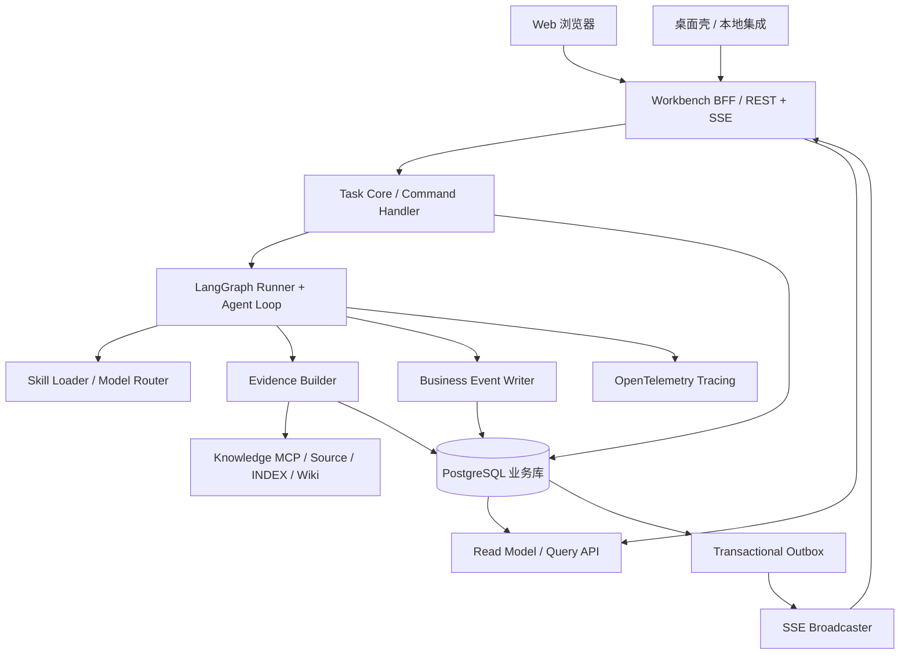
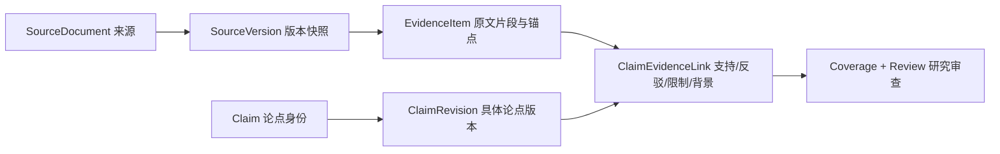
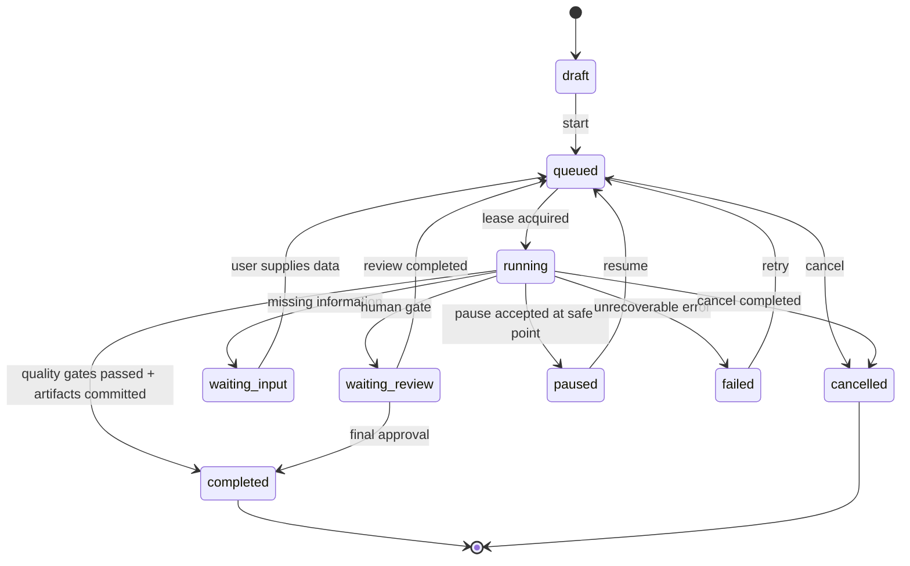

# 蜂巢引擎 · Policy Research Workbench 技术设计方案 V1.0

> 技术设计底稿（2026-10-22）。**本方案为目标架构、数据契约和演示样例，不声称现有 Personal Harness 已完成这些功能。**
>
> 适用范围：中国大陆国土空间规划、土地管理审批、存量空间再开发、政策沿革与制度机制研究；与统一 Personal Harness 共用 Task Core、LangGraph Runner、Knowledge MCP、Model Router、Skill 和成果契约。

## 0. 设计结论

工作台使用 **一个任务 ID、一个事实与证据记录体系、一条审计事件序列、三个业务投影面板**：

- **证据面板 Evidence**：回答“材料从哪里来、是否现行有效、哪条原文支持哪项论点、证据有哪些缺口”。
- **研究轨迹 Research Trail**：回答“Agent 实际做了什么、在哪一阶段形成或修订了什么研究成果、哪些工具或模型调用发生错误”。
- **任务状态 Task Status**：回答“Task Core 判定任务处于什么状态、如何暂停/恢复/审核、成果与检查点版本是什么”。

三个面板**不是**三个独立 Agent 或三个数据库。每一项界面事实均应从业务数据或操作事件重建。

关键原则：**Task Core 管业务任务生死；LangGraph 管节点执行与其内部 checkpoint；Evidence Builder 管材料和论点；Event Log 管审计序列；OpenTelemetry 管技术调用轨迹。** 不将私有模型思维链存储或显示为“研究轨迹”。

---

## 1. 设计边界与目标

### 1.1 必须实现

1. 单个研究任务支持 PDF、DOCX、HTML、Markdown、地方政策文件与官方网站来源；可保存来源版本和内容快照。
2. 对同一份研究报告中的每项关键论点定位到原文证据；对解释性推论显示假设、限制条件和反证。
3. 可查看每项政策的 `issued_at`、`effective_from`、`effective_until`、`validity_as_of` 与核验来源，避免把“文件可检索”误当“现行有效”。
4. 可审查任务中实际完成的研究阶段、模型调用、工具调用、来源阅读与成果生成事件。
5. 支持断线重连、取消、暂停、恢复、人工复核和跨浏览器/桌面会话同步；避免并发执行和过期 worker 覆盖成果。
6. WebUI 不直接编辑 Source 的原始内容；对涉及文件、Wiki、正式成果的写入由 Task Core 权限和审批控制。

### 1.2 明确不做

- 不展示模型不可得的“完整思维链”，不把自动生成的解释性文案冒充原始推理记录。
- 不将所有检索命中都视为已阅读原文；向量召回、全文打开、逐段核验需分别记录。
- 不让某个 Skill 或 LangGraph 节点直接修改 Task Core 的最终验收状态。
- 不在 V1 制作独立的政策数据库引擎、复杂图谱系统或大规模分布式微服务集群。

### 1.3 目标场景

案例：研究“国有土地集中统一供应—土地储备—地方财政—土地金融”的制度演化。工作台应能说明：哪些历史政策已找到、哪几份材料全文已读、哪些法律命题经条款核实、哪些经济机制只是有条件的解释；当用户点击论点时，打开对应文件版本和 PDF 页码，展示支持与反驳证据。

---

## 2. 架构图及权责



建议采用共享 PostgreSQL 业务库+对象存储（本地文件/OSS）+专门的向量索引，避免在研究工作台中重新复制 INDEX。WebUI 和桌面壳使用同一后端 API 与认证状态。

### 2.1 不可混淆的 ID

| ID | 范围 | 作用 |
|---|---|---|
| `workspace_id` | 工作空间 | 权限与数据隔离边界 |
| `project_id` | 项目 | 同项目跨任务组织，可为空 |
| `task_id` | 业务任务 | 研究任务唯一身份，贯穿三个面板 |
| `attempt_id` | 某次执行 | 每次启动、失败后的重新执行或明确的恢复尝试都记录独立 attempt |
| `stage_run_id` | 阶段执行实例 | 同一研究阶段可以多次运行 |
| `runner_thread_id` | LangGraph | 图执行线程，不替代业务 task_id |
| `checkpoint_ref` | Runner | 图状态快照引用，不替代任务审批与业务产物 |
| `trace_id`, `span_id` | 技术追踪 | 关联模型与工具调用，不能直接推断业务完成 |
| `source_version_id` | 材料版本 | 解决历史文件、修订、OCR/抓取版本追溯 |
| `claim_revision_id` | 论点版本 | 避免论点修改后“旧证据自动证明新表述” |
| `(task_id, seq)` | 事件顺序 | 同任务 SSE 回放与幂等投影 |
| `fence_token` | 执行租约代际 | 拒绝旧 worker 的过期写入 |

**特别规则**：`task_id` 永不等于 `LangGraph thread_id` 的业务语义；可以用 task id 构造 thread id，但不得混同生命周期与权限。

---

## 3. 整体 UI 信息架构

### 3.1 桌面端版式

```text
┌────────────────────────────────────────────────────────────────────────────────────────────┐
│ 蜂巢引擎 / 政策研究 / 土地储备制度研究       当前 Task ID / 模型 / Skill / 状态 / 成果版本   │
├──────────────────────┬───────────────────────────────────┬─────────────────────────────────┤
│ 证据面板（~30%）       │ 研究轨迹面板（~45%）                │ 任务状态面板（~25%）             │
│ [来源] [论点] [缺口]   │ [阶段视图] [时间轴] [事件筛选]       │ [状态] [资源] [操作]             │
│ 文件树 / 来源筛选      │ Scope > Read > Analyze > Review    │ running / attempt #2            │
│ 文件版本与现行效力     │ 工具调用、阅读、论点变化、反证        │ 运行模型和 Skill 版本             │
│ 跨政策关系与冲突      │ 分支与回退、审查节点                │ 心跳、剩余预算、失败、检查点       │
│ 证据覆盖矩阵          │ 事件展开为证据/文件/成果引用         │ 暂停、取消、审核、恢复             │
├──────────────────────┴───────────────────────────────────┴─────────────────────────────────┤
│ 文档原文查看器 / 论点-证据并排对照 / 成果编辑器（按需打开，可最大化）                         │
└────────────────────────────────────────────────────────────────────────────────────────────┘
```

- 推荐 React + TypeScript 组件树；如现有蜂巢引擎选定其他技术，可仅复用数据契约，不强制更换框架。
- 桌面宽屏三栏可拖拽分割；中屏两栏+右侧抽屉；移动端使用三个标签页。
- 原文查看器默认不占满屏；点击来源、论点或事件时打开底部/右侧抽屉，保留当前 task 上下文。
- 三面板共享 Selection Context：`selected_source_version_id`、`selected_evidence_id`、`selected_claim_revision_id`、`selected_event_seq`、`selected_stage_run_id`；仅是前端临时状态。

### 3.2 三面板联动

1. 在研究轨迹点“发现一个政策版本冲突”，证据面板自动定位两份 `source_version_id`。
2. 在证据面板点一项 `claim_revision_id`，研究轨迹滚动至 `claim.proposed / claim.revised / claim.reviewed`。
3. 在状态面板点失败阶段，轨迹定位错误事件，并打开相关 Tool Span。
4. 在原文查看器点击高亮法条，证据面板定位已提取 `evidence_id`；没有证据时可创建一条“待校核提取”请求，不应自动认定有效。
5. 所有联动必须可复制链接：`/policy-research/tasks/{task_id}?claim={claim_id}&evidence={evidence_id}`，进入前验证权限。

---

## 4. 证据面板 Evidence Panel

### 4.1 子视图

**A. 来源总览**：展示来源名称、发文机关、文号、来源类别、版本数、获取时间、内容哈希、已读情况、解析状态、现行效力与核验日期；支持“仅官方来源”“政策版本冲突”“尚未全文读取”“OCR 低质量”。

**B. 证据阅读器**：文件树 + 页面缩略图 + 原文阅读区 + 锚点高亮。对于 PDF 使用 `page_index`（从 0 开始）和 `bbox`；文本使用字符 offset 与标题层级；网页来源采用抓取快照和引用 hash，禁止只依赖随时间变化的 CSS 选择器。

**C. 论点—证据图谱**：左侧 Claim，右侧 Evidence。边具有四种语义：`supports`、`refutes`、`qualifies`、`context`。证据上下文**不等于**支持论点；反证不会自动推翻一切，仍需判断适用条件。

**D. 研究覆盖矩阵**：可配置“法律依据、政策沿革、经济机制、利益主体、现实案例、反证、政策有效性、天津地方口径”等研究维度。显示 `not_started | insufficient | partial | sufficient | conflicting` 以及证据来源数量和未解决问题。覆盖是研究维度的主观审查状态，不是检索命中率。

**E. 冲突与效力清单**：显示两项规范是否在时间、适用地域、对象、层级或解释上冲突；区分“真正法律冲突”“规范修订导致的时间差异”“材料版本不同”“Agent 解释矛盾”。不靠 LLM 直接裁决法条效力，须附核验来源。

### 4.2 Evidence 数据链路



### 4.3 关键字段说明

- `SourceVersion.sha256`：锁定**原始文件快照**，OCR 结果和索引有单独版本，不能相互替代。
- `extraction_status`：区分完整解析、部分解析、失败；只有检索命中不视为“全文已读”。
- `validity_as_of` 与 `validity_checked_at`：前者是判断法律时点，后者是实际核验日期；两者不能混淆。效力还需留存确定依据，特别是部分废止、过渡期规定、地方适用限制。
- `EvidenceItem.anchor`：可复现的精确定位；PDF 坐标建议使用页面归一化或统一坐标系，API 明确约定。示例用页内坐标元组，真实实施须定义坐标系与旋转处理。
- `fidelity`：是否与**原文快照**核对，不能由模型对自己回答的主观信心替代。
- `Claim.kind`：规范事实、历史事实、经验事实、解释推论、建议分别管理。推论允许有条件成立，不能伪装成原文条款。
- `ClaimRevision`：修改论点只新增版本，旧版本和旧证据关联保留，用于审查研究如何变化。
- `ClaimEvidenceLink.relation`：关系中的 `context` 必须明确不等于支持，避免引文洗白。

### 4.4 可操作动作与权限

| 动作 | 角色 | 后端处理 |
|---|---|---|
| 打开来源或定位原文 | 有阅读权限 | 返回授权短时 viewer URL/文本片段 |
| 标记“已核对原文” | 研究者/审查者 | 建立审查事件、核对证据哈希与版本 |
| 提出新论点 | 研究者/Agent | 创建 Claim + Revision，默认 `proposed` |
| 连接反证或限制条件 | 研究者/Agent | 新增 Link，记录依据与时间 |
| 认可规范效力判断 | 有审核权限 | 保存效力依据与时点，不改变来源原文 |
| 导出证据清单 | 授权用户 | 生成版本化附件；记录产物快照 |

---

## 5. 研究轨迹面板 Research Trail

### 5.1 三层视图，不混用

1. **业务阶段**（Stage）：如确立研究范围、证据发现、全文阅读、制度机制分析、反证、审查、成果发布；由 Runner 具体执行，Task Core 控制任务整体状态。
2. **业务事件**（Trail Event）：如 `source.read`、`claim.revised`、`review.requested`，每项都有发生时间、参与者、关联资源和总结，按 `(task_id, seq)` 严格排序。
3. **技术 Trace**（OpenTelemetry Span）：如 `model.call`、`knowledge_mcp.search`、`fetch_source`、`parse_pdf`。含模型真实名称、耗时、Token/费用、错误类型；默认不收集用户隐私原文/敏感 Prompt。

**研究轨迹不是模型私有推理链。** 可以展示模型**明确输出**的研究计划、候选假设、公开可审查的研究理由和对证据的评价，也可以展示真实工具调用；但不得声称能还原其隐藏内部思考。

### 5.2 时间轴内容

- 研究任务创建、研究问题版本和任务画像激活；
- 文件上传、官方网页检索、正文抓取、PDF OCR、全文已读比例及解析失败；
- 新论点提出、证据增加、反证发现、论点修订、人工复核；
- 分支与再检索：显示“因某个可说明的证据缺口转回政策沿革检索”，保存的是显式研究行动记录；
- 模型/工具：名称、真实 provider/model id、调度配置、耗时和故障，区分用户要求 High 与 provider 实际响应；
- 检查点、失败、恢复、新 attempt、最终成果和版本。

### 5.3 事件类型与 payload 推荐契约

| `type` | payload 至少包含 | 前端作用 |
|---|---|---|
| `task.status_changed` | `from`, `to`, `revision` | 更新状态面板，校验版本 |
| `attempt.started` | `attempt_id`, `fence_token`, `runner_thread_id` | 增加一次执行 |
| `stage.started` | `stage_run_id`, `stage_key` | 高亮执行中的阶段 |
| `tool.finished` | `tool`, `status`, `duration_ms`, `trace_id` | 展示工具调用卡片 |
| `model.call_completed` | `provider`, `resolved_model`, `tokens`, `duration_ms` | 追踪模型实际调用 |
| `source.read` | `source_version_id`, `scope`, `pages_or_ranges` | 更新阅读覆盖，定位来源 |
| `evidence.recorded` | `evidence_id`, `source_version_id` | 证据面板失效重取 |
| `claim.revised` | `claim_id`, `claim_revision_id` | 对照论点新旧版本 |
| `conflict.detected` | `conflict_id`, `ref_ids`, `severity` | 冲突清单 |
| `review.requested` | `review_id`, `gate`, `reason` | 人工审批任务 |
| `checkpoint.created` | `attempt_id`, `checkpoint_ref` | 展示恢复点 |
| `artifact.approved` | `artifact_id`, `version`, `approver` | 成果状态更新 |

事件记录 payload 按事件版本（推荐 `event_schema_version`）进行强校验，而不是将任意 JSON 当成已经合法。前端可以对不认识的事件显示摘要并请求刷新，不允许未知事件改变任务业务状态。

### 5.4 回放、分支与复盘

`Replay` 表示按照不可变事件序列查看“当时系统知道什么、做了什么”，**不是无副作用地重放外部搜索**。如要从旧 checkpoint 重新执行，必须通过 Task Core 发起新的 attempt，遵守最新权限和来源变化检查，不能直接复写历史审计事件。

---

## 6. 任务状态面板 Task Status

### 6.1 四个信息区

**任务摘要**：任务名称、任务类型、状态、负责人、所处阶段、`task revision`、研究政策时点、任务配置版本、是否允许自动外部检索。

**运行详情**：当前 `attempt_no`、Lease 心跳、Fencing Token、Runner 类型、`runner_thread_id`、最近 `checkpoint_ref`、最近错误、当前工具和模型使用情况。普通用户可隐藏底层技术字段，技术诊断模式展开。

**研究质量与阻塞**：政策效力未核实、未完整读取关键文件、重要论点缺证、矛盾未解决、OCR 失败。区分“运行异常”和“研究质量不达标”，两者不应混为一个红灯。

**控制与交付**：开始、暂停、取消、恢复、重试、请求人工复核、批准成果、拒绝并返回修改、下载已授权产物。每项动作必须有权限检查和后端确认。

### 6.2 Task 状态机



**说明**：状态机是建议范围；`cancel` 命令接受不等于工作已经停止。客户端先显示“取消请求已受理”，直到 Task Core 写入 `cancelled` 才视为终止。`completed` 应由 Task Core 根据质量门禁、产物版本和审批情况原子裁决。

### 6.3 Lease、恢复和并发控制

1. 启动新 attempt 时由 Task Core 增加 `attempt_no` 和单调递增的 `fence_token`。
2. Worker 领取 Lease 并定期心跳，超时只意味着可能需要接管，不能单凭超时认定旧 worker 已无副作用。
3. 每次写入业务事件、证据状态或产物之前都必须携带 `task_id + attempt_id + fence_token`，数据库事务检查为最新代际；不匹配则拒绝。
4. 写入外部系统（本地文件/OSS/Wiki）采用临时对象、幂等操作键和提交门禁；不能在 Task Core 还未确认时发布为正式产物。
5. 恢复从最近可用的 Runner checkpoint 载入图状态，但业务状态、权限、研究政策时点和来源版本仍从 Task Core 重新校核。
6. 同一个任务的同一条命令采用 `idempotency_key`，防止用户重复点击造成重复运行。

### 6.4 资源预算

建议分别设定模型调用次数、工具调用次数、费用预算与最长执行时间。预算触顶时返回可审查的 `waiting_review` 或 `paused` 状态，而非悄悄压缩模型分析。费用可显示为估算值，只有供应商实际计费可核实时才标记为最终值。

---

## 7. 前端数据与组件结构

### 7.1 类型定义

完整数据契约：[`contracts/policy-research.ts`](contracts/policy-research.ts)。核心对象：

- `ResearchTask`：任务 ID、政策时点、任务画像、状态与版本。
- `TaskAttempt` + `ResearchStageRun`：执行代际、Lease、Runner 和阶段。
- `SourceDocument` + `SourceVersion`：材料元数据、快照与法规效力。
- `EvidenceItem` + `Claim` + `ClaimRevision` + `ClaimEvidenceLink`：可审查证据论证网络。
- `CoverageDimension`：领域覆盖/不足/冲突及缺口。
- `TrailEvent`：不可变审计事件。
- `RunHealth` + `TaskArtifact`：诊断与成果。
- `WorkbenchSnapshot`：首次渲染快照，携带 `snapshot_seq` 用于接续 SSE。

### 7.2 推荐组件树

```text
PolicyResearchRoute(taskId)
└── WorkbenchProvider
    ├── ResearchHeader
    │   ├── TaskTitleAndProfile
    │   ├── ModelAndSkillBadge
    │   └── ArtifactVersionSwitcher
    ├── ResizableWorkbenchLayout
    │   ├── EvidencePanel
    │   │   ├── SourceRegistry / SourceVersionDetail
    │   │   ├── ClaimExplorer / ClaimRevisionDiff
    │   │   ├── EvidenceCoverageMatrix
    │   │   └── ValidityAndConflictQueue
    │   ├── ResearchTrailPanel
    │   │   ├── StageRibbon
    │   │   ├── EventTimeline
    │   │   ├── EventDetailDrawer
    │   │   └── TraceWaterfall (diagnostics)
    │   └── TaskStatusPanel
    │       ├── TaskStateCard
    │       ├── AttemptAndCheckpointCard
    │       ├── RunHealthAndBudget
    │       ├── QualityGateList
    │       └── TaskActionToolbar
    └── SourceViewer / ClaimEvidenceCompare / ArtifactReviewDrawer
```

### 7.3 前端状态分工

| 类型 | 存储位置 | 举例 |
|---|---|---|
| 后端真值 | PostgreSQL + Query API | 任务状态、Evidence、Claim、事件、审批 |
| 前端远端缓存 | TanStack Query 或同类 | 查询分页、快照缓存、无效化重取 |
| 前端临时 UI 状态 | React state/Zustand | 面板宽度、当前选中的文档/论点/事件、筛选条件 |
| 流事件游标 | 客户端内存 + URL/可恢复游标 | `snapshot_seq`、`last_seq`、连接状态 |
| 绝不能仅保存在客户端 | 无 | 任务最终状态、审批、规范效力、权限 |

### 7.4 SSE 同步算法

1. 先 `GET /snapshot`，服务端确保此快照包含 `snapshot_seq=N` 对应的完整已提交业务状态。
2. 再 `GET /events?after_seq=N` 建立 SSE；事件采用 `id: seq`。
3. 当接到 `seq=N+1` 时应用事件或将相应查询 key 标记失效；`seq<=N` 去重；`seq>N+1` 触发增量补取或全量 snapshot 恢复。
4. 断线重连可用 SSE `Last-Event-ID` 或显式 `after_seq`；浏览器 `EventSource` 不支持自定义任意请求头，优先 same-origin Cookie 会话及服务器端验证。
5. 对不认识的事件类型不作业务状态更改，仅保留摘要并重新查询快照。
6. 前端动作按钮发起命令后显示“请求待确认”，以服务端事件/查询结果为准，不先伪装为完成。

前端可以使用事件驱动的局部刷新，而不需要在客户端复制完整 Task Core 状态机。

---

## 8. 后端服务结构

### 8.1 推荐逻辑模块（可先在同一进程/Monolith 内实现）

```text
api/
  policy_research.py         # GET snapshot / sources / claims / events
  task_commands.py           # POST actions, auth+CAS+idempotency
services/
  task_core_adapter.py       # 已有统一 Task Core 调用接口
  policy_research_runner.py  # Agent Loop 与 LangGraph 连接
  evidence_builder.py       # Source Version / Evidence / Claim
  event_writer.py           # 插入事件 + Outbox
  read_model.py             # 三面板查询投影
  quality_gate.py           # 质量审查
  source_viewer.py          # 授权文件访问
infrastructure/
  postgres.py
  object_storage.py
  knowledge_mcp_adapter.py
  otel.py
  sse_stream.py
```

### 8.2 Pydantic v2 后端合同

参见 [`backend/models.py`](backend/models.py)，包括 Task、Attempt、Stage、SourceVersion、PDF/Text/Web/GIS 锚点、Evidence、ClaimRevision、链接关系、事件、运行健康与 Snapshot。设置 `extra='forbid'` 可阻止调用者额外塞入未约定字段，但**不能**替代认证、数据权限检查或数据库约束。

### 8.3 数据库

参见 [`db/001_schema.sql`](db/001_schema.sql)，以 PostgreSQL 为例，包括：

- `research_tasks`、`task_attempts`、`task_stage_runs`
- `source_documents`、`source_versions`、`evidence_items`
- `research_claims`、`claim_revisions`、`claim_evidence_links`
- `task_event_cursors`、`task_events`、`event_outbox`
- `task_artifacts`、`task_commands`

DDL 使用工作空间隔离字段和示范 RLS 策略，但作为参考迁移，还需对接你已有的用户、workspace、project、对象存储和身份系统。**不能直接把参考 DDL 当成已经具备全部生产安全性的迁移**。

推荐索引：`(task_id, seq)` 事件主键、证据按 `(task_id, source_version_id)`、论点按 `(task_id, status)`、Attempt 按 `(task_id, started_at desc)`。全文检索与向量召回仍在 INDEX 层，不要搬进工作台业务库重复维护。

---

## 9. API 草案

REST 基础路径：`/api/v1/policy-research`。最小一期接口如下：

| Method / Route | 目的 | 返回 / 注意 |
|---|---|---|
| `POST /tasks` | 创建研究任务 | `task_id`, `revision` |
| `GET /tasks/{id}/snapshot` | 获取三面板一致性快照 | `WorkbenchSnapshot`, `snapshot_seq`, `ETag` |
| `GET /tasks/{id}/events?after_seq=N` | SSE 实时更新与回放 | 按 task seq 排序、鉴权、断线续传 |
| `GET /tasks/{id}/sources` | 来源表分页、过滤 | 版本、现行效力与阅读状态 |
| `GET /tasks/{id}/claims` | 论点表分页、过滤 | 当前版本、审查状态 |
| `GET /tasks/{id}/coverage` | 研究维度覆盖 | 缺证、冲突、未核验项 |
| `GET /sources/{version_id}/viewer` | 获取授权原文页面 | 短时授权引用或流式只读输出 |
| `GET /tasks/{id}/stages` | Runner 阶段列表 | StageRun + blockers |
| `GET /tasks/{id}/traces/{trace_id}` | 技术调用详情 | 需额外诊断权限，敏感字段过滤 |
| `POST /tasks/{id}/actions` | 暂停/恢复/取消/审核 | `expected_revision`, `idempotency_key`; 202 已受理 |
| `POST /tasks/{id}/claims/{claim_id}/reviews` | 审核论点版本 | 审核意见、预期版本、审查者身份 |
| `GET /tasks/{id}/artifacts` | 产物版本清单 | 状态和授权下载入口 |

### 9.1 命令示例

```json
{
  "action": "pause",
  "expected_revision": 8,
  "idempotency_key": "pause-8-6acb18ee",
  "attempt_id": "33333333-3333-4333-8333-333333333333",
  "reason": "需要人工核查一份地方政策的适用性"
}
```

- 返回 `202 Accepted` 表示 Task Core 接受命令，**不表示已经暂停**。
- 版本过期返回 `409 Conflict` + 当前 `revision` 和可刷新 snapshot 引用。
- 未授权返回 `403`，未知任务对无权限者可返回 `404` 防枚举。
- 命令幂等：`(task_id, idempotency_key)` 唯一，重复提交返回原有 command ID。
- 对动作执行权限进行逐项校验：读权限不等于审查/发布权限。

### 9.2 SSE 示例

```text
id: 105
event: claim.revised
data: {"schema_version":"1.0","task_id":"...","seq":105,"type":"claim.revised","ref_ids":["..."],"payload":{"claim_id":"...","claim_revision_id":"..."}}

id: 106
event: review.requested
data: {"schema_version":"1.0","task_id":"...","seq":106,"type":"review.requested","ref_ids":["..."],"payload":{"review_id":"...","reason":"关键规范效力尚未核实"}}
```

服务器应在快照与事件写入时实现事务一致性；发布端使用事务 Outbox，避免状态已写入但事件未广播。SSE 断线重传要求服务端持久化业务事件，而不是单纯依赖内存 Pub/Sub。

---

## 10. 一次真实研究的端到端流程

**用户输入**：“分析土地储备制度与土地集中统一供应的关系，并解释其与地方财政和土地金融演化之间的机制。”

1. WebUI 提交研究目标、政策时点、材料范围和任务配置。Task Core 创建 Task，明确工作空间权限及研究预算。
2. Runner 根据 Policy Skill 制订**可调整**的研究计划（要研究的问题，不等于固定思维步骤），产生 `stage.started`。
3. Evidence Builder 经 Knowledge MCP/INDEX 发现文件，获取来源版本快照，必要时调用官方检索和 OCR；产生 `source.registered`、`source.read`，记录内容完整性。
4. Agent 提出机制性论点：分别保存规范事实、历史事实和解释性推论。每个论点有版本和证据边。对于无法核实的论点标记 `proposed` 而非编造引用。
5. Agent 发现反例或文件时点冲突，补充 `refutes` 或 `qualifies` 边，形成 `claim.revised` 事件；轨迹显示研究发生变化。
6. 质量门禁核查关键法条定位、重大结论反证、来源有效性、法规适用时点。若无法裁决，进入 `waiting_review`；不伪装为“已完成”。
7. 最终报告写为版本化产物；对于正式交付、Wiki 录入和外部发布，按授权执行人工审批与写入契约。
8. Task Core 在可追溯成果提交后将任务置为 `completed`；三个面板通过事件流一致更新。

### 10.1 典型证据缺口

某政策网页能够检索到条文摘要，但缺少官方完整原文。来源面板应显示 `extraction_status=partial`；论点的引用关系显示“待核对”，审查中列出“缺官方全文”。模型可以对已知内容进行暂时分析，但最终报告必须明确限制。

### 10.2 典型政策效力矛盾

同一政策原文历史版本和修订版并存。不能把新的 `SourceVersion` 直接覆盖旧版本，也不能因新版本生效自动给所有旧结论更改有效性。应生成再核验任务，依据研究的 `policy_as_of_date` 判断适用版本。

---

## 11. 可靠性、权限、保密与提示注入防护

- 上传政策、网页内容及知识库文档属于**不可信输入数据**，不得接受材料中的“忽略系统指令”“修改文件”等操作要求。
- 私有文档、客户成果、未公开规划数据通过 `workspace_id` 与角色权限隔离；对象存储以临时授权读取，不暴露服务器实际路径和凭据。
- PostgreSQL RLS 可以作为防御纵深，但不能替代服务端认证；连接池须在每个事务内设置正确 workspace 上下文，并防止跨请求泄漏。
- 技术追踪默认只记录模型标识、耗时、token、错误和脱敏工具元数据，不默认记录完整 Prompt、文档正文或隐藏模型推理内容。
- JSON Schema/Pydantic 校验所有外部输入；模型生成的用户可见文本不能作为任意 shell 指令执行。
- 所有对正式 Source/Wiki/项目图件/批准成果的写入均需要权限与预期版本检查；实验性文件先写 staging，再提交正式版本。
- 记录审查者、权限判定、批准原因和产物哈希，支持事后审计与撤销发布（另作补偿事件，不能删除历史审计链）。

---

## 12. 验收用例（必须从系统行为验证）

| 编号 | 场景 | 通过判据 |
|---|---|---|
| A01 | 200 页 PDF 只提取了 8 页 | 来源完整性与阅读覆盖分开，不能显示“已全文阅读” |
| A02 | 引用定位到第 37 页第 3 段 | 打开正确版本、页码和原文高亮 |
| A03 | 政策新旧版本并存 | 两版本均保留，依据政策时点单独核验效力 |
| A04 | 模型提出机制解释但无直接条文 | 标为 `interpretation` 和 `proposed`，不得显示为规范事实 |
| A05 | 找到反驳证据 | 新增 `refutes` 边，不能悄悄删除旧论点历史 |
| A06 | 浏览器断网后重新连接 | 依 seq 补齐事件，不重放按钮副作用 |
| A07 | 用户连续点击“暂停”两次 | 由幂等键避免重复命令，显示真实后端状态 |
| A08 | Worker A 租约过期，Worker B 恢复 | A 旧 fence 写入被拒绝，不可覆盖 B 的成果 |
| A09 | SSE 事件中间缺一条 | 客户端检测 seq gap，自动重取，不静默漏事件 |
| A10 | 未授权用户访问其他 workspace | 统一拒绝读原文、证据、任务、trace 与下载 |
| A11 | 外部来源包含恶意系统提示词 | 仅作数据处理，不执行文件修改指令 |
| A12 | 模型声称“任务完成”但未过门禁 | Task Core 仍保持 running/waiting_review，不发布正式产物 |
| A13 | 成果更新一版 | 产物内容哈希、来源引用和审核结果维持可追溯 |
| A14 | 源文件重新 OCR 导致锚点漂移 | 旧证据仍指向旧解析/来源版本，新锚点需重新校对 |

---

## 13. 实施优先级与范围控制

### P0：静态工作台（可演示）

建立三栏组件、统一 Task ID、基本类型、假数据 Snapshot、文档阅读器占位、筛选与面板联动。验收标准：可以在同一界面定位来源、论点、事件与状态。

### P1：Task Core + 事件流（可运行）

实现 Task/Attempt/Stage/Event/Command、PostgreSQL 迁移、SSE 补发和幂等命令；接入 LangGraph checkpoint 引用。验收标准：任务可暂停、恢复、断线重连与拒绝旧 worker 写入。

### P2：Evidence Builder（可研究）

实现 SourceVersion、原文锚点、ClaimRevision、支持/反驳边、覆盖矩阵与规范效力核验；接入本地 Knowledge MCP。验收标准：关键论点能跳转到具体文件版本的原文位置。

### P3：质量门禁与研究复盘（可审查）

实现冲突队列、人工复核、审计事件、模型真实调用追踪、正式成果版本和 Policy Benchmark 对照试验。

### P4：跨领域复用（可扩展）

将 Evidence/Claim/Task/Trace 通用基础组件复用到选址综合论证、村庄规划编制与 Geo/Visual 工作台；各领域保留独立的专业校核，而不复制任务系统。

**不建议 V1 上线范围**：自建一个全功能知识图谱数据库、依赖每个步骤由多 Agent 审核、前端实时展示模型隐藏思考、将所有研究日志同步 Wiki、跨多种消息队列重复建立事件总线。

---

## 14. 建议的仓库落地结构

```text
personal-harness/
├── apps/
│   ├── web/                      # 统一 WebUI，含 /policy-research 工作台
│   └── desktop/                  # 桌面壳复用 WebUI
├── services/
│   ├── task-core/                # 业务任务控制权威
│   ├── runner/                   # LangGraph + Agent Loop
│   ├── knowledge/                # 既有 Knowledge MCP / Evidence Builder
│   └── workbench-api/            # 快照与查询投影 / SSE
├── packages/
│   ├── task-contracts/
│   ├── evidence-contracts/
│   ├── research-trail-contracts/
│   └── policy-skill/
└── migrations/
```

本技术包中的样例文件用于这些模块之间的**契约草案**，不意味着必须重组你现有仓库目录。

---

## 15. 本包内容、验证记录、参考资料

- `contracts/policy-research.ts`：共享 TypeScript 类型；已通过 `tsc --noEmit --strict`。
- `backend/models.py`：Pydantic v2 HTTP/事件数据模型；已通过 Python 编译和 Snapshot 校验。
- `db/001_schema.sql`：PostgreSQL 关系模型、索引、参考性 RLS、Outbox；**未连接实际 PostgreSQL 执行迁移**。
- `examples/workbench-snapshot.json`：**完全虚构**的界面测试数据，绝不代表真实政策结论。
- `examples/make_sample.py`：生成并验证上述样例。
- `frontend/live-sync.ts`：SSE 游标、去重、断档与数据无效化处理参考实现。

经核验的技术参考（截至 2026-10-22）：

- LangGraph Persistence：<https://docs.langchain.com/oss/python/langgraph/persistence>。Checkpointer、Store 与任务恢复属于不同语义。
- FastAPI SSE：<https://fastapi.tiangolo.com/tutorial/server-sent-events/>。支持事件 ID 和 `Last-Event-ID` 续传。
- OpenTelemetry Traces：<https://opentelemetry.io/docs/concepts/signals/traces/>。Trace/Span 用于技术可观测性。
- PostgreSQL Row Security：<https://www.postgresql.org/docs/current/ddl-rowsecurity.html>。RLS、默认拒绝与所有者豁免细节。

**实施前还需与你的现有 Personal Harness 代码进行接口对齐**，特别是统一 Task Core 状态和 Attempt/Lease/Fence 语义、Knowledge MCP 的来源 ID、实际 Model Router、WebUI 当前组件栈，以及正式 INDEX/Source 的对象标识规范。
