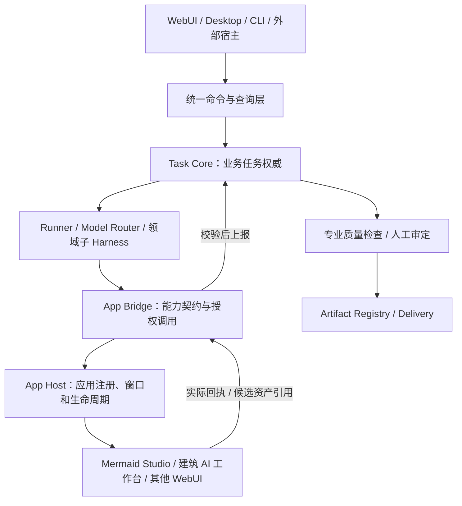

# 蜂巢引擎 V12：App Host / App Bridge 分层协作与桌面工作台技术方案

> 文档性质：目标架构、接口草案与 V12 概念演示说明。2026-10-22。\
> 来源基线：用户上传《蜂巢引擎 V11 · 完整项目包.zip》，并在此基础上执行增量升级。V11 的 `apps/03_WebUI`、`apps/Mermaid_Flow_Studio`、Policy Research 工作台、Geo Pro Bridge、APLE/ANTR、Visual Prompt Builder 等内容完整保留。\
> **真实性边界：V12 新增 App Bridge 流程全部为浏览器内模拟，未调用真实外部 WebUI 或 Task Core，也未赋予任何现有应用新的写入权限。**

## 1. 核心思想：从网页集合到专业工具网络

此前 App Host 是「应用目录 + 多标签 + iframe + 本地服务」。它解决**独立网页怎样被打开、由谁运行、如何退出**，但没有解决独立工具如何参与一个经过统一治理的专业任务。

新的目标链路是：



图是职责结构，不表示 App Bridge 必须通过 App Host 才能调用业务 API。**App Bridge 既可以通过应用侧服务 API 直接调用，也可以与宿主的嵌入容器协作。** App Host 不应成为所有结构化任务的强制执行通道。

### 1.1 三层边界

| 组件 | 负责什么 | 不负责什么 | V12 状态 |
|---|---|---|---|
| App Host | 注册、启动、健康检查、WebView/iframe/独立窗口、多标签、进程隔离 | 业务正确性和正式任务完成判断 | V11 已有静态宿主演示与本地启动器，V12 保留 |
| App Bridge | 发现 Capability Manifest、类型校验、授权范围映射、交付输入、回收回执/成果 | 自行运行第二套 Task Core、绕过权限 | V12 仅接口概念与交互模拟 |
| Task Core | Task/Attempt/Lease/Fence/取消核验、验收门禁、资产接受事件 | 应用内部按钮操作或私有数据管理 | 既定架构；非本包部署内容 |
| Host Adapter | Codex、OpenCode、DSH 等外部 Agent 宿主与自身任务系统的受控适配 | 充当 App Host 或任意应用的万能插件系统 | 独立设计方向 |

另外：专业 Sub-Harness（Policy/Visual/Geo 等）决定业务方法和判断；独立 App 仅是能力工具。外部页面是否装进宿主，与某一能力是否可以被 Task Core 调用，是两个可分开的决定。

## 2. V12 三个专业场景

### 2.1 Policy → Mermaid Studio → Delivery

背景：进行存量建设用地盘活的政策研究，需要将条款、适用条件和论点依赖关系绘制为可编辑结构图。

1. Policy Harness 已生成带 `source_ref`、`claim_revision` 的 `DiagramSpec` 候选，不把模型自由文本当作已证实政策事实。
2. Task Core 确认调用 `diagram.open` 的项目范围与安全等级。
3. App Bridge 选择 Mermaid Studio 适配器，交付结构化图数据和任务标识；如应用未实现 L2，则退化为用户手动导入 Mermaid 源码（L1）。
4. 用户修改节点和连线；应用回传 `.mmd` 源文件、`.svg` 候选图，以及真实能力执行回执（未来实现）。
5. Policy Harness 核对所有声称的政策关系是否有证据。Delivery 登记两种文件和所引用的原文版本。
6. 应用导出成功、专业核验通过、人工接受是不同事件。不能让 `diagram.export` 自动使 Task 状态变成 `accepted`。

### 2.2 Visual → 建筑 AI 工作台 → ImageTask/Canvas

背景：以卫星影像为基底，生成保留街区空间结构的建筑水彩风格交通分析底图；再把局部道路改为低饱和单线形式。

1. Visual Prompt Builder 形成含原图引用、保留对象、变更范围和视觉约束的 `ImageTask`。
2. App Bridge 将 `prompt.import` 转成独立建筑 AI 工作台支持的业务输入格式（未来需应用端适配）；不把外部图片二进制直接暴露给网页中任意脚本。
3. 在工作台内完成提示词微调、候选对比或 ComfyUI 配置；返回受控资产引用和编辑差异。
4. Canvas 记录版本与编辑分支；Visual Harness 做结构偏移和保护对象检查。
5. 候选图片不能冒充 GeoResult、法定规划图或通过真实测量的空间对象。

### 2.3 Geo → WebGIS 发布与审阅

背景：ArcPy Worker 完成地类叠加、面积统计和空间质量检查，或者 ArcGIS Pro Bridge 产生规范图件，需要发布至独立 WebGIS 工作区供项目组审阅。

1. Geo Harness 记录数据来源、CRS、运算、质量结果和 `GeoResult`。
2. Asset Registry 接受合格空间成果，并由 Geo Publishing Adapter 转为矢量数据、OGC/REST 服务、矢量瓦片或栅格瓦片等适宜类型。
3. App Bridge 调用 WebGIS `layer.open`，传递**可访问的发布资产引用**，而不是假设 `.gdb` 或 `.aprx` 能直接在浏览器渲染。
4. WebGIS 展示、查询和汇总人工批注。几何编辑、面积量测仍回到受控 Geo 执行器。
5. 输出审阅记录与引用关系，不能凭网页显示成功判断 GIS 运算和法律成果合规。

## 3. L0—L3：渐进接入，不强制全部改造

| 级别 | 实现内容 | 接入是否改原 App | 自动协作能力 | 出错时的退化 |
|---|---|---|---|---|
| L0 网页承载 | 登记 URL、运行方式、原生窗口/iframe、标签状态 | 不需要 | 无，人工使用 | 外部独立窗口 |
| L1 资产交换 | 允许导入/导出文件，记录文件引用或用户确认 | 可能不需要；可通过人工导入 | 有限 | 下载/上传手动移交 |
| L2 结构化能力 | 统一 Capability Manifest、适配器、调用、真实回执 | 通常需要 Adapter/API | 按能力执行单步或流程节点 | L1 手工操作 |
| L3 Task Core 协作 | Task/Attempt/Fence、可恢复操作、事件对账、质检与人工门禁 | 需深度契约 | 受控专业任务节点 | 拒绝高风险自动化并请求人工干预 |

**交互原型**：在 `App_Collaboration_Workbench_Concept_V12.html` 可以选择 L0、L1、L2、L3，并模拟 L2/L3 的调用路径。即便界面显示“模拟授权通过”，也不代表已经连通真实 Task Core；L0/L1 状态不得模拟为自动结构化调用成功。

## 4. 四份数据契约与一份资产记录（建议稿）

### 4.1 Host Manifest

```json
{
  "schema": "hive.host_manifest/0.2-draft",
  "app_id": "mermaid-studio",
  "entry_url": "http://127.0.0.1:7860/",
  "runtime": "static-http-service",
  "launch_ref": "controlled-local-app-registration",
  "ui_modes": ["iframe", "external-window"],
  "allowed_origins": ["http://127.0.0.1:7860"],
  "healthcheck": {"method": "GET", "path": "/"},
  "data_owner": "app-local",
  "host_permissions": ["open-view"],
  "business_permissions": []
}
```

### 4.2 Capability Manifest

```json
{
  "schema": "hive.capability_manifest/0.2-draft",
  "app_id": "mermaid-studio",
  "capabilities": [
    {"id": "diagram.open", "input_schema_ref": "DiagramSpec/v1", "output_schema_ref": "AppOpenReceipt/v1", "effect_level": "interactive"},
    {"id": "diagram.export", "input_schema_ref": "DiagramExportRequest/v1", "output_schema_ref": "ArtifactBatch/v1", "effect_level": "create-asset"}
  ],
  "status": "PROPOSED_NOT_IMPLEMENTED"
}
```

能力必须来自经过准入的应用版本及适配器，不能因为某个网页自称支持某动作就立刻授权执行。

### 4.3 AppInvocation / Task Context

```json
{
  "schema": "hive.app_invocation/0.2-draft",
  "task_id": "TASK-123",
  "attempt_id": "ATTEMPT-02",
  "fence_token": "opaque-taskcore-issued-token",
  "command_id": "CMD-135",
  "app_id": "mermaid-studio",
  "capability": "diagram.open",
  "input": {"type": "DiagramSpec", "asset_ref": "artifact:diagram:draft:v3"},
  "scope": ["read-asset", "open-edit-view"],
  "expected_input_revision": "v3",
  "idempotency_key": "TASK-123:ATTEMPT-02:CMD-135",
  "approval_ref": "taskcore-approval-opaque",
  "deadline_at": "2026-10-22T10:00:00+08:00"
}
```

### 4.4 Tool Receipt / AppOperationResult

```json
{
  "schema": "hive.app_receipt/0.2-draft",
  "command_id": "CMD-135",
  "app_id": "mermaid-studio",
  "task_id": "TASK-123",
  "attempt_id": "ATTEMPT-02",
  "status": "succeeded",
  "started_at": "2026-10-22T09:59:10+08:00",
  "finished_at": "2026-10-22T09:59:14+08:00",
  "output_artifacts": ["artifact:diagram:edited:v4"],
  "source_revision": "v3",
  "executor_version": "adapter-1.0.0",
  "observed_effect": "new-candidate",
  "task_core_acceptance": false,
  "evidence_ref": "receipt-store:CMD-135"
}
```

任何内容均需以实际适配器生成、受控通道采集和检查后才可称为真实回执。不能把浏览器里合成的 JSON 当作事实证明。

### 4.5 Artifact Registry

应至少持有 `artifact_id / version_id / type / producer / source_refs / checksum / trust_state / review_state / export_uri / dependency_fingerprint`。资产位置可以变化，资产引用应稳定。若源证据版本变更，要标记下游候选可能过期，而不是无条件覆盖历史成果。

## 5. 桌面 WebUI + App Bridge 的实现方式

**推荐主线**：保持独立 HTML / WebUI First → 统一 Command Gateway / API → App Host 薄桌面宿主（WebView2 或同等控件）→ 面向专业用途的 App Bridge Adapter。

- **Host 前端消息**：在明确可信的来源上使用 `postMessage`/Channel，但检查 `origin`、实例 ID、一次性随机挑战、消息 schema、操作允许范围和回包关联；不从非白名单来源接受通用系统指令。
- **Bridge 后端通信**：能从服务端 API 直接调用时，优先走独立 adapter；接口只绑定 loopback 不等于免鉴权，仍需能力准入与授权票据。
- **UI 与执行分离**：打开 WebUI（L0）不自动启动其后台 AI 或专业计算。浏览器页面不持有通用 Python 命令执行权限，也不直接编辑 Task Core 数据库。
- **可靠性**：应用掉线时 App Host 可以展示重连按钮；App Bridge 将执行状态标记 `unknown` 并进行回执对账；不能只因 HTTP 超时就立即重复有副作用的执行。
- **取消**：用户请求停止 ≠ 应用/Worker 已停止。需要操作状态、幂等、重入和重复事件处理；过期 Attempt 不得回写当前成果。
- **桌面与 Web 共用**：WebUI 的专业工作台、数据契约、App Registry 和 API 共用；Windows 宿主只增补进程、窗口、文件对话框等原生能力。

## 6. 当前 V12 真正实现了什么

| 内容 | 当前事实 |
|---|---|
| 产品展示页 | 在 V11 `index.html` 新增三层架构区、案例交互演示和导航入口，保留旧版专业专题 |
| 桌面概念原型 | 新增 `App Bridge · 应用协作` 页面，原 App Host 与 Policy Research 保留 |
| 协作工作台 | 浏览器内真实可操作：三情境、等级切换、流程推进、输出记录、审查动作、JSON 下载 |
| 真实独立 WebUI | V11 原 `apps/` 完整保留；仍按本地服务运行，不在新页面中收到数据调用 |
| App Bridge 真实协议实现 | **未实现**。所有协作事件包含 `simulated: true` |
| Task Core/Agent Runtime | **未连通**，没有真正的任务完成、撤销及恢复权限 |
| 专业审定 | **未执行**。UI 中的接收状态仅为演示分支 |

## 7. 下一步的最小真实纵切片

不需要先全面重构两套独立 WebUI。建议优先落地 **Policy → Mermaid** 的单能力链，验收：

1. 基于真实版本的 `DiagramSpec` 创建一个待编辑资产；Task Core 接受编辑任务，生成有身份和权限限制的单次命令。
2. Mermaid Studio 适配器提供 `diagram.open`：对数据进行 Schema 校验，并验证浏览器是否成功打开对应版本的图。
3. 用户修改后调用 `diagram.export`：生成 `.mmd` 和 SVG 两个候选，确实写入受控 staging 区，而非只返回虚拟路径。
4. App Bridge 返回由执行者真实采集的回执，并携带输出文件校验和；Task Core 对账、检测过期 attempt，不将返回成功直接转为 accepted。
5. 质量检查验证图形源与 SVG 一致，Policy 复核政策关系依据，用户人工确认后 Delivery 接受新版本。
6. 断开服务、取消请求、编辑冲突、重复请求、跨任务引用、来源失效六种失败情况都有可观察状态与回退。

成功后再做 Visual → 建筑 AI，最后做 Geo 发布 → WebGIS；二者的特殊数据类型和真实专业验收条件另行补足。

## 8. V12 演示使用与修改位置

- `index.html` → 页面内 `#v12-app-collaboration`，可见三层关系及内嵌交互示例。
- `HiveEngine_Desktop_Concept_v0.9_AppCollab.html` → 侧栏「App Bridge · 应用协作」。原「独立 WebUI · 应用中心」仍可打开真正的子应用。
- `App_Collaboration_Workbench_Concept_V12.html` → 独立完整交互 HTML，也作为内嵌 `srcdoc`，确保离线预览不依赖 iframe 同源服务器。
- `start_hive_workspace.py` → 更新 8760 宿主白名单，允许上述新 HTML，仍不开放 `apps/` 数据目录。
- 原 V11 的 `Policy_Research_Workbench_Concept_V11.html`、全部外部应用与资源、旧 README 和 MANIFEST 文件按原样保留。

**注意**：源码中的嵌入式 `srcdoc` 是为离线原型准备的静态快照。将来维护时应建立自动构建脚本，从唯一源文件生成两个嵌入副本，避免三个页面的示例代码分叉；当前目录下 `build_v12_reembed.py` 提供了重新同步这一副本的参考实现。

## 9. 最终架构决策

**保留原始 WebUI 的自主性、统一外部应用的协作契约、保持 Task Core 唯一业务权威。** App Host 是基础设施，App Bridge 是能力适配，Host Adapter 是外部 Agent 宿主接入，三者共用语义对象但职责独立。蜂巢引擎的成功标准不是窗口内可以打开多少网页，而是专业任务能否安全地跨工具流转，并产生来源可追、版本可查、可恢复、可验证的成果。
