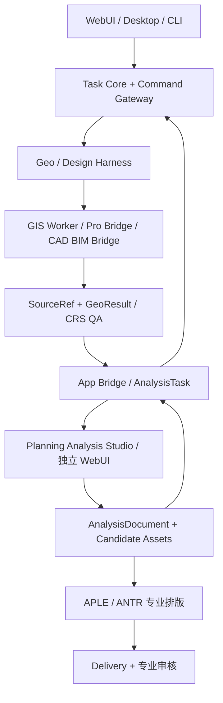

# 蜂巢引擎 V13 · 规划设计分析图工作台技术设计与接入契约

> 2026-10-22 · V13 目标方案、真实 HTML 原型说明。用户要求在 V12 基础上加入独立 WebUI，并与产品展示/桌面概念原型和历史源码包相互衔接。

## 1. 目标定位

独立的 Planning Analysis Studio（规划设计分析图工作台）将来源各异的空间数据与参考资料组织进统一专业图件。使用对象涵盖国土空间规划、详细规划、城市设计、村庄规划和综合选址研究。它并非取代 Geo Harness、ArcGIS Pro、CAD/BIM、APLE 或 Visual Harness；它负责多源可视化、图层组织、二维编辑、三维体量观察、分析图表达与中间设计资产。

## 2. 产品交互流程

1. 项目选择与数据入站：矢量 GIS、表格 XY、影像、后续 GDB/GeoPackage/DXF/IFC。
2. Source Registry：数据来源、校验、版本、空间参考、访问权限与依赖。
3. Geo 图层环境：2D 与 3D 共用对象标识、可见性、专题与样式；二维可绘制带来源的注释与分析覆盖。
4. 分析表达：用地、交通、生态、开发约束等主题，生成可复核的图面组成。缓冲、叠加、等时圈、面积、坡度等运算必须交由真实 Geo Worker。
5. Planning AnalysisDocument：包含 Layout、SourceRef、Annotation、ViewState、Style、Revision 与 QA。
6. App Bridge：获得 Task Core 授权后才能调用应用能力；返回图件资产和真实 Tool Receipt。
7. APLE/ANTR 与 Delivery：图件可以作为图纸的输入，但正式制图、原生布局、审查与版本接受分别执行。



## 3. 当前离线 V13 原型已实现的功能

- HTML/CSS/JavaScript 独立运行，无外部 CDN。
- 合成城市街区图层与主题：建筑、道路、水系、绿地、结构廊道。
- 本地 GeoJSON 点、线、面和 CSV（XY、经纬度字段名）导入；所有输入只在浏览器内解析。
- 图层显隐、透明度、缩放定位、专题主题切换。
- 在 2D 绘制点标注、分析线、分析范围与文字，支持撤销、ESC 取消草稿。
- 用同一套图形对象进行 Canvas 几何投影的三维体量**示意**，可调方位、俯仰角与建筑挤出比例。这不是地形引擎或测绘级三维模型。
- 2D SVG、当前画面 PNG、AnalysisSpec 和 Project JSON 导出，及 Project JSON 再加载。
- PNG/JPG 仅作为尚未配准的参考背景，不能与真实地理数据假定空间对齐。
- 提供只读 capability 描述应答示例，但**不是**已接通的正式 App Bridge。

## 4. 未实现边界及专业数据要求

| 数据/能力 | V13 离线情况 | 真实实现建议 |
|---|---|---|
| GeoJSON / CSV | 可在浏览器显示，但仅范围映射 | Geo Worker 统一 CRS 与投影，输入规范化 GeoPackage / PMTiles / MVT 等 |
| JPG / PNG 影像 | 无配准背景示意 | GeoTIFF/COG/World File + GeoRegistration 处理，保存 georeferencing |
| GDB、SHP、GeoPackage | 未解析 | ArcPy/开源 GIS Worker 读取并输出适用的视图格式，保留字段与 CRS |
| CAD DXF/DWG / IFC/BIM | 未解析 | DCC/CAD Bridge 和授权转换，保存空间基准、单位、模型身份 |
| 精确 Buffer / Overlay / Spatial Join | 未实现 | Geo Harness 运行确定性算法并返回 GeoResult |
| 真实三维地图/地形 | 未实现；只支持 Canvas 投影视图 | 可选 MapLibre GL JS / deck.gl / CesiumJS + 3D Tiles / DEM，配合离线资源发布 |
| 原生规划图纸 | 未实现 | APLE DocumentSpec → RenderPlan → ArcGIS Pro 原生对象 / QA |
| 任务、权限与协作 | 概念界面，未接 Task Core | App Host / App Bridge 协议、授权与实际回执 |

特别注意：无配准影像不能被默认为 GeoTIFF，普通 CSV 坐标没有 CRS 时不得推断为 WGS84，画布图形像素坐标与地图投影坐标不得混淆。浏览器输出的面积与距离均不得用于专业报审。

## 5. App Host 与 App Bridge Manifest（建议）

```json
{
  "app_id": "planning-analysis-studio",
  "host": {
    "entry_url": "http://127.0.0.1:<port>/",
    "embedding": "same-origin-webview-or-authorized-frame",
    "health": "/health"
  },
  "capabilities": [
    {"name": "analysis.open", "input": "AnalysisTask", "effect": "interactive"},
    {"name": "layer.import", "input": "GeoAssetRef", "effect": "read-plus-view"},
    {"name": "annotation.edit", "input": "AnalysisDocument", "effect": "user-confirmed"},
    {"name": "diagram.export", "output": ["SVG", "PNG", "AnalysisDocument"], "effect": "asset-create"}
  ],
  "governance": "Task Core remains authoritative; app never self-accepts professional completion"
}
```

示例 Manifest 是草案；`<port>` 是待填写占位符，非真实监听地址。App Bridge 不应默认把工作目录、专业软件或数据库写入权限赋给嵌入页面。

## 6. 建议数据契约

```ts
interface AnalysisTask {
  taskId: string;
  attemptId: string;
  capability: 'analysis.open' | 'layer.import' | 'annotation.edit' | 'diagram.export';
  inputAssets: Array<{assetId:string; revision:string; crs?:string; fingerprint:string}>;
  expectedOutputs: string[];
  authorizationRef: string;
  deadline?: string;
}
interface AnalysisDocument {
  documentId: string;
  revision: string;
  sourceRefs: string[];
  crs: string | null;
  layers: unknown[];
  annotations: unknown[];
  view2d: unknown;
  view3d: unknown;
  presentation: unknown;
  reviewStatus: 'candidate' | 'needs_review' | 'accepted';
}
interface AnalysisReceipt {
  invocationId:string;
  taskId:string;
  attemptId:string;
  appId:'planning-analysis-studio';
  outcome:'succeeded'|'failed'|'cancelled'|'unknown';
  outputAssetRefs:string[];
  warnings:string[];
  startedAt:string;
  finishedAt?:string;
}
```

## 7. 示例专业工作流

**城市设计交通系统分析图**：通过 Geo Harness 校核路网及空间参考 → Map View 显示道路与建筑 → 建立公交、慢行、停车和公共活动系统的分层表达 → 绘制规划策略箭头与界面注记 → 切三维观察街区关系 → 转 APLE 规范出图并生成有证据的报告图件。2D/3D 视图应共享路网身份，表现图不得篡改道路空间事实。

**村庄规划土地利用分析图**：导入现状/规划地类与村庄建设边界 → 按规划地类与最新分类口径生成渲染规则 → 进行用地指标的专业计算 → ANTR 导入 Excel 控制指标表 → APLE 组合图例、位置图、比例尺和表格 → 交付可编辑 APRX + PDF。当前工作台只支持其中的图面表达与示意标注。

**选址核查约束图**：Policy Harness 提供适用的管控条件与依据 → Geo Worker 真实叠加生态红线、永久基本农田、开发边界等要素 → Analysis Studio 比较约束、标注问题图斑 → Delivery 输出审查附图。模拟图中的彩色斑块不能替代真实法定边界。

## 8. 最小验收切片

1. **L0**：桌面 App Host 能稳定打开独立工作台，切换标签不会丢失场景。
2. **L1**：App Host 导入一份经过 CRS 校核的 GeoAsset（包含坐标与版本），应用显示后回传 AnalysisDocument 候选。
3. **L2**：App Bridge 可调用 `analysis.open`、`diagram.export`，返回带 checksum 的真实回执；拒绝未授权调用。
4. **L3**：Task Core 管理 attempt、fencing、取消对账、恢复、正式资产登记，人工审定与运行成功分开。

重点检验数据对齐、图层可见状态、二维与三维的对象身份一致性、重开后版本一致、错误导入时不污染正式数据。当前 V13 仅达到 L0 前端原型的概念交互与浏览器本地导出。
