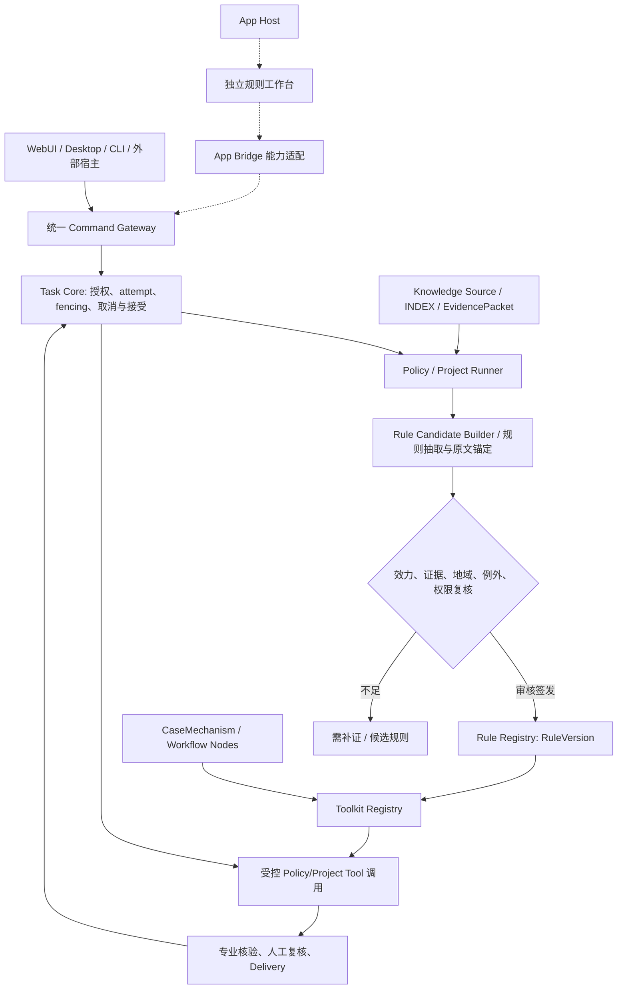

# 蜂巢引擎 Personal Harness V14｜政策规则资产与项目工具包体系

> 2026-10-22 · 项目展示与交互概念原型 + 用户提供 V3 Policy Research 后端源码的整合设计文档。
> **来源边界**：以下 V3 数量、具体机制、API 来自上传项目包的源码与数据文件；V14 Rule Registry、Toolkit Registry、任务治理接口属于建议方案，不代表已联通。

## 1. 设计动机：将一次性研究转为可复用专业能力

政策研究常形成散落的长篇报告。再次遇到相似项目时，需要重新检索依据、重建事实、查找办理环节。仅用 RAG 搜索旧报告并不足以解决“哪些条件适用、为什么不能适用、谁来提供证据、具体办理什么步骤”。

因此需要将 **SourceVersion / ResearchClaim / CandidateRule / RuleVersion / CaseMechanism / WorkflowNode / ProjectToolkit** 区分存储并建立不可逆的验收门槛。

- **Source** 是原文证据，不是已核定的规则。正式资料及版本须归 Knowledge / INDEX 的受控入口。
- **ResearchClaim** 是研究判断，需记录引用、反证及不确定性。
- **CandidateRule** 是从 Claim 生成的结构化条件，不能自动视为现行有效。
- **RuleVersion** 是经过专业审核与时点核查后发布的规则快照。
- **CaseMechanism** 保留真实案例事实、障碍和历史办理证据等级。
- **WorkflowNode** 是可组合的办理/核查动作，依赖图不等于有权机关批准。
- **ProjectToolkit** 是一个特定目标的规则、案例、流程、表单、Skill 与验收标准的带版本组合包。

## 2. 上传 V3 的实证检查

| 核查项 | 观察结果 |
|---|---|
| 后台框架 | `backend/server.py` 中的 FastAPI、Pydantic；`/api/analyze` 通过 `reasoning_v3.analyze_v3` 执行 |
| 规则库 | `backend/data/rules_v3.json`，**15** 条政策工具，带条款、适用地域、日期、证据、例外、审批参与方 |
| 条件表达 | V3 规则中可见 `eq`、`neq`、`in`、`gte`、`permittedConversion`，另有运行时专项条件分支 |
| 案例库 | `case_workflows.json`，**20** 项案例，保留案例障碍、历史报告路径与卷宗缺口 |
| 通用节点 | `workflow_nodes.json`，**42** 项办理或审查节点 |
| 案例节点使用关系 | 20 模板共 **266** 个节点使用引用 |
| 依赖关系 | `case_workflow_edges.json` 记录 **332** 条研究性前后置候选边 |
| 原文/报告 | 包内含部分政策原文 PDF/Markdown 及 20 个案例 HTML/MD 报告 |
| 测试 | 当前沙盒运行 `python -m pytest -q tests`，**39 passed** |

**注意**：V3 README 另列 78 项基础条件，运行时还有附加专项条件。规则覆盖不等于完整现行法律、所有行政程序或政策的线上有效性验证。

### 2.1 V3 已实现的状态

`candidate_conditions_met`、`requires_verification`、`excluded_by_known_facts`、`outside_jurisdiction`、`not_effective_on_date`。

即使出现 `candidate_conditions_met`，也只说明已编码事实条件初筛满足，**绝不等于获得规划、土地或建设许可**。

### 2.2 V3 明确未完成的能力

尚未自动联网核实废止与修订、自动核验证据真实性、联通审批登记系统、自动办理许可、Agent 主动工具调用、服务端项目持久化、正式 Task Core 注册。原案例分析未持有全部历史行政卷宗；编排节点不能冒充历史案情原本已办理的步骤。

## 3. 正式体系中的职责分工



App Host 是可选的 UI 承载层；App Bridge 是结构化任务与结果交换层；业务权限仍在 Task Core。独立 V3 FastAPI 不应复制 Task Core 的权威状态。

## 4. RulePack 与 ProjectToolkit 的边界

### 4.1 RulePack（规则资产包）

最小字段建议：`rule_id`, `rule_version`, `jurisdiction`, `effective_interval`, `source_refs`, `articles`, `conditions`, `exceptions`, `exclusions`, `authority_roles`, `evidence_requirements`, `review_status`, `approved_by`, `supersedes`, `content_hash`。

RulePack 必须支持 `unknown`、时间截面 `as_of`、地域类型、条件触发、例外、冲突和补充适用规则。规则回退/撤销需要版本和依赖失效事件，不可静默覆盖旧结论。

### 4.2 CasePack（案例机制包）

最小字段建议：`case_id`, `fact_version`, `source_refs`, `reported_path`, `observed_obstacles`, `evidence_level`, `mechanism`, `workflow_template_refs`, `transfer_limitations`。必须标明哪些节点基于公开案例事实，哪些是对未来项目的研究性推演。

### 4.3 ProjectToolkit（项目工具包）

可组合：`RulePackRefs`、`CasePackRefs`、`WorkflowNodeRefs`、`SkillRef`、`FactFormSchema`、`EvidenceChecklist`、`ProfessionalQA`、`DeliveryTemplateRefs`。Toolkit 本身是编排与装配对象，不是审批意见。

V14 概念原型提供六类 **源规则/案例行为标签自动组合的候选工具包**：工业与用途转换、既有建筑业态与过渡期、节余土地与二级市场、历史遗留及权籍补正、近远结合与改建更新、集体低效与乡村产业。六类分类是**本次建议的归纳方案**，不是 V3 已发布的六个官方工具包。

## 5. 可复用工作流的正确执行方式

```
用户创建项目事实档案（事实未知 = unknown）
→ 选择专业目标/时点/地域
→ 执行版本固定的 Policy RulePack
→ 逐条件给出事实、证据、结果和冲突
→ 从 CasePack 发现可比障碍与失败边界
→ 组合 WorkflowNodes（依赖检查、责任、材料）
→ 输出待核清单、候选办理路径与专业报告
→ 人工检查政策效力、当地机关、审批卷宗
→ Task Core 决定业务任务是否接受
→ Delivery 组装可编辑成果并登记版本
```

## 6. 源码 API 与建议接口

V3 已有：`GET /api/health`、`GET /api/policies`、`GET /api/cases`、`GET /api/workflow/nodes`、`GET /api/workflow/templates`、`POST /api/analyze`。详见包内 `Policy_Rules_V3/docs/03_引擎接口与证据契约.md`。

后续**建议但尚未实现**：

- `POST /rule-candidates`：将 ResearchClaim 转为待审候选规则。
- `POST /rule-reviews`：审查条款定位、生效时间、地方适用性和证据。
- `POST /rule-versions/publish`：仅经授权发布规则快照。
- `POST /toolkit-drafts/compose`：装配工具包与依赖图，状态保留 draft。
- `POST /task-commands/run-toolkit`：经 Task Core 准入、执行者绑定后调用可用工具。
- `GET /artifact-registry/{id}`：只返回已登记的引用、核验状态和版本。

建议响应完整记录 `task_id`, `attempt_id`, `fence_token`, `rule_snapshot`, `as_of`, `input_fingerprint`, `condition_receipts`, `workflow_edges`, `evidence_gaps`, `human_review_status`, `artifact_refs`。这些字段应先与真实 Task Core Schema 对齐，不可直接覆盖。

## 7. 实际接入方式与 App Host

当前包原封保留用户 V3 的后台、WebUI、规则数据、案例报告、启动脚本和测试。V14 另外提供独立单文件离线工具包装配界面 `Policy_Toolkit_Studio_V14.html`，其 JSON 内嵌 V3 元数据，只执行查询、流程浏览和候选装配，**不会在浏览器里伪造真实 Python 规则引擎结果**。

开启真实 V3 服务（Windows）：进入 `Policy_Rules_V3` 目录，先执行 `pip install -r requirements.txt`，再执行 `启动后台.bat`，访问 `http://127.0.0.1:8765/`。V14 桌面原型中的 App Host 也登记了此服务地址；没有启动后端时，该入口无法工作。若原应用设置其他端口，须同步修改其配置。生产环境应验证来源限制、CORS、认证、WebView 沙箱及 API 最小权限，不应把 localhost 当作无需授权。

## 8. 核心案例：从天津项目研究到工具包

### 8.1 存量工业项目

将 `TJ01 红桥光荣道产业园` 作为案例机制参考，在当前项目中首先核查权利、原用途、用地空间边界、园区资格、控规和地价约束。候选规则如 `TJ37-02`、`TJ37-16` 只在对应事实/地域/行为满足时考虑。需要原始土地合同、审批资料、规划图等才能评价；案例成功不代表当前项目获准。

### 8.2 历史遗留建筑

`TJ11 武清工业厂房以函代证` 的案例流程可以暴露历史建设、权利来源、鉴定、补正及资料问题。`TJ95` 规则是否适用还需满足具体时间、地域和历史事实条件。V3 的工作流生成是分析建议，不能冒充该案例的原始行政卷宗。

### 8.3 不同地域的资产盘活

全国性指导意见在异地提供政策方向或基础制度，天津专用工具不得不经本地实施细则直接复制到昆明、宁波或无锡。工具包应阻止跨域默认为“条件满足”。

## 9. 原型与真实系统的分界

| 内容 | V14 交付状态 |
|---|---|
| V3 FastAPI 初筛引擎/测试 | 保留可运行原始源码，测试通过；未经过实际项目正式验收 |
| 15规则/20案例/42节点资料浏览 | 独立离线 WebUI 已实现 |
| 候选工具包装配及 JSON 导出 | 已实现浏览器前端交互，但只是研究草案 |
| 展示页/桌面工作台/App Host 入口 | 已完成静态网页集成 |
| 原始政策最新效力联网复核 | 未实现 |
| Rule Registry 版本发布/签发权限 | 目标设计，未实现 |
| 正式 Task Core/Knowledge INDEX 接入 | 目标设计，未实现 |
| 执行真实行政审批或专业许可 | 不支持，也不应承诺 |

## 10. 后续验收建议

1. 核验一个规则的真实原文锚点、日期、例外和证据，并记录审核者版本。
2. 以天津工业转用及历史补证各构造正例、反例与 unknown 输入，验证 fail-closed。
3. 使用真实案例资料检查节点依赖、缺失证据和办理机构，不把模拟办理状态当作事实。
4. 从 RuleVersion + CaseMechanism 生成 ToolkitDraft，并运行受控的 V3 分析请求。
5. 通过 Task Core 正式驱动并对账调用，失效或撤销后可以追溯旧分析快照。
6. 让不同入口共享一个 Task ID 和成果版本，而不共享不存在的伪审批结果。
